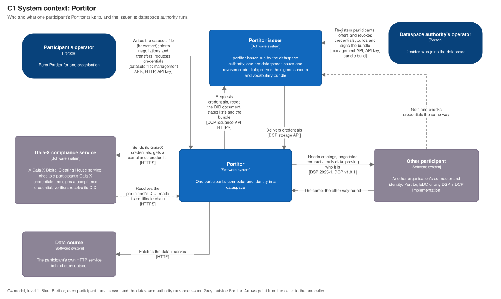
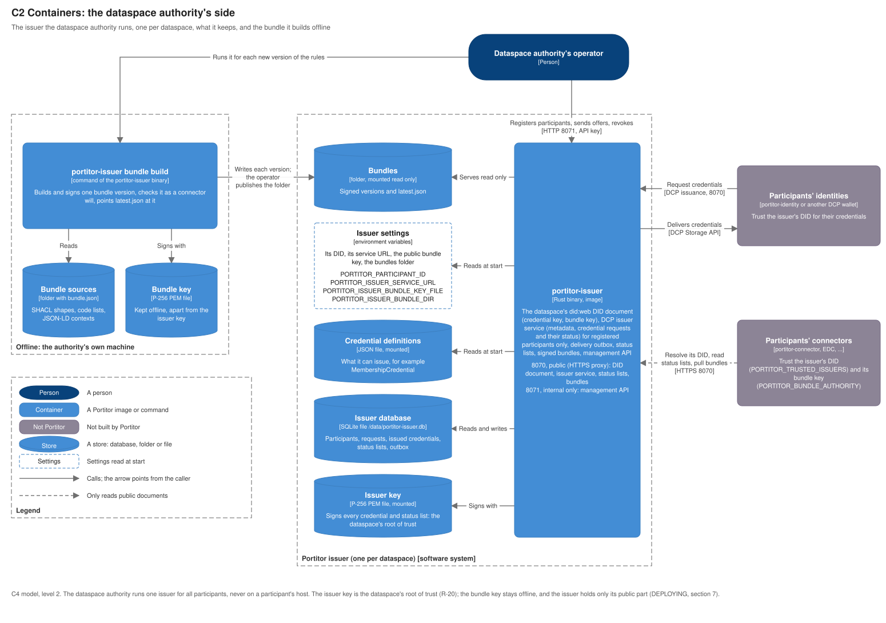
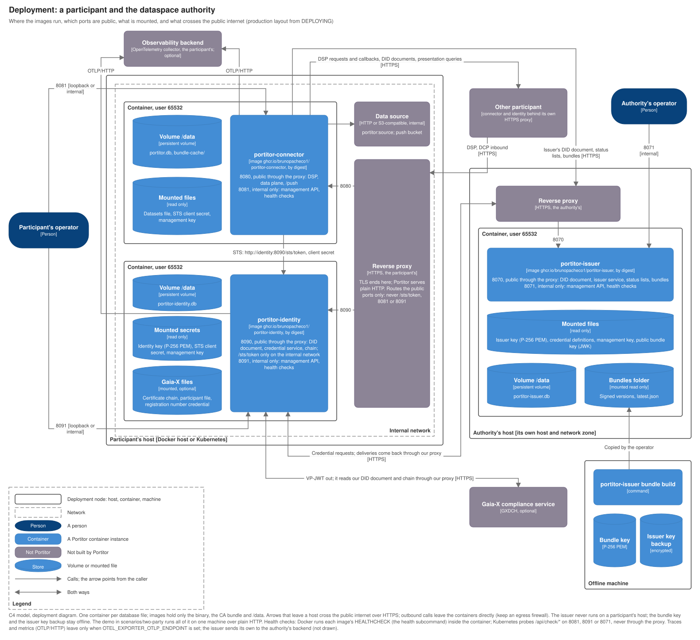
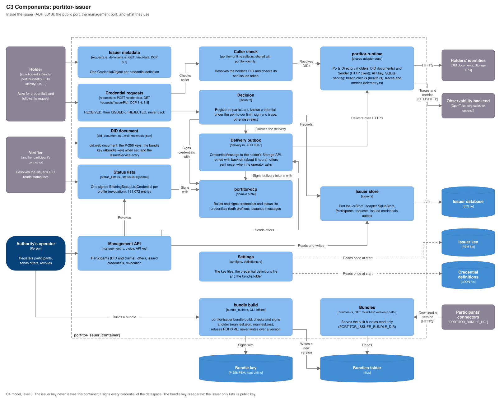
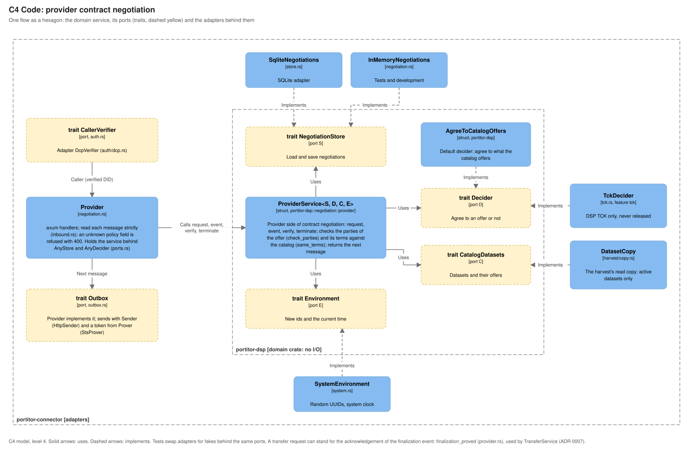
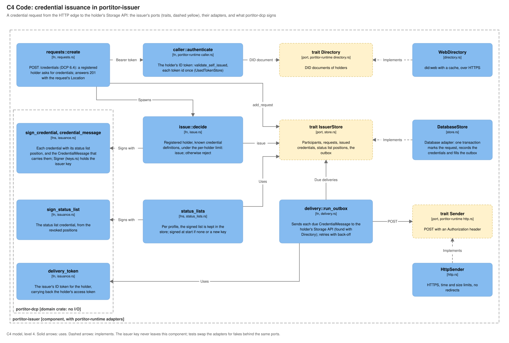
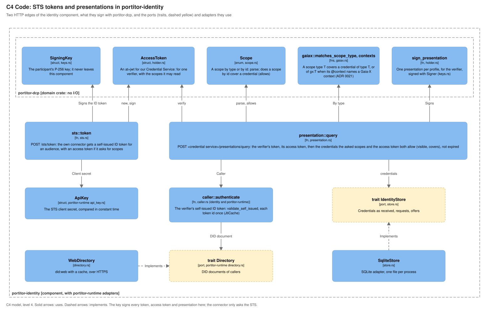
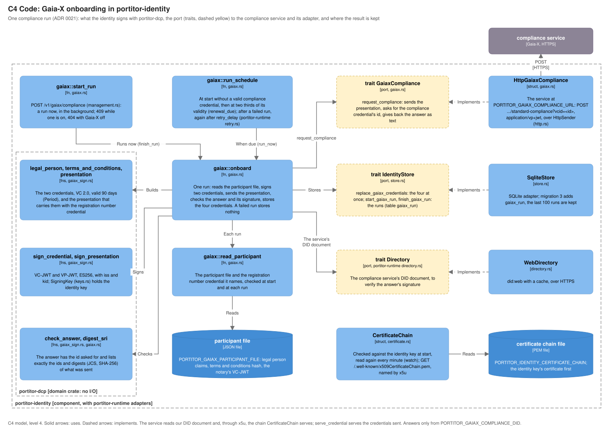
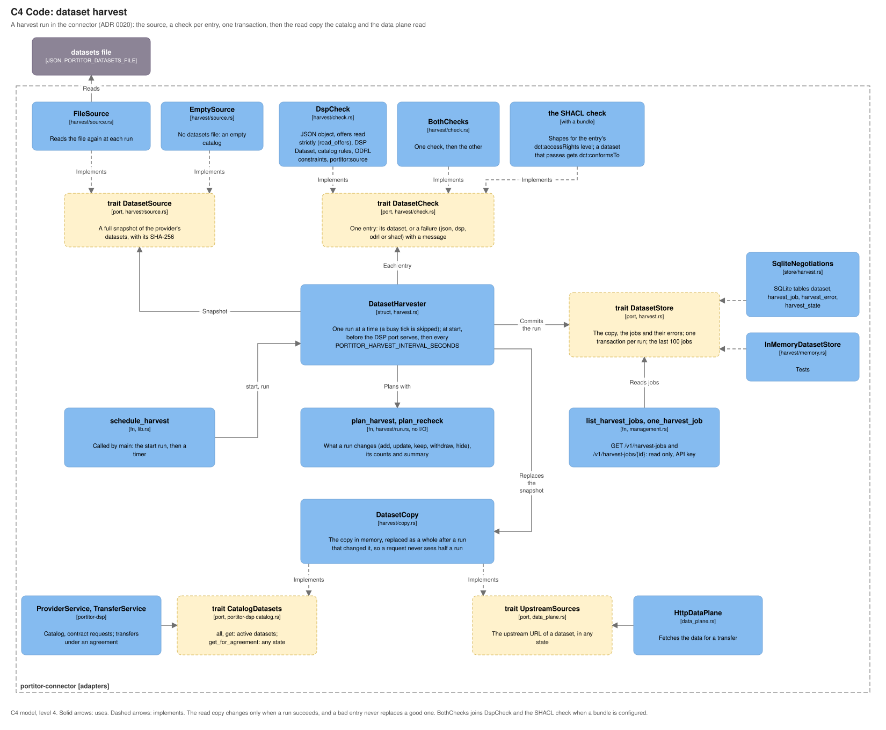

<!--
SPDX-FileCopyrightText: Portitor contributors

SPDX-License-Identifier: Apache-2.0
-->

# Architecture (draft)

Status: **draft for review**. Language: Rust ([ADR 0002](adr/0002-technology-stack.md), accepted).

## Goal

A small and fast connector that speaks the Dataspace
Protocol (DSP 2025-1) and the Decentralized Claims Protocol (DCP v1.0.1), with
few components and a simple deployment order.

## Architecture principles

Each principle has a short reason and a check, so a pull request can be
judged against it.

1. **Standards first.** Implement DSP, DCP, Data Plane Signaling and the
   Gaia-X Trust Framework as published; no private protocol extensions.
   Where a spec is silent, follow Eclipse EDC's behaviour and record it in
   an ADR. *Check:* every external endpoint cites its spec section; the
   DSP and DCP TCKs run in CI.
2. **Interoperability is tested, not assumed.** EDC and Simpl-Open are
   the reference counterparts ([ADR 0011](adr/0011-interoperability-targets.md)).
   *Check:* an interop test per protocol flow runs in CI from 0.5.
3. **Few components, one version.** One mono repo and one version for all
   components. Each component is a module of the repo and can ship as its
   own image. A new component needs an ADR. *Check:* the component list
   stays small and every component has a clear owner role and deployment
   step.
4. **Small and predictable.** No garbage-collector pauses on the request
   path, bounded memory, fast start. *Check:* the image size, memory,
   startup and p99 latency targets in ADR 0002 are measured on every
   release.
5. **Strong types at every boundary.** Each message type is its own type;
   invalid messages fail at parsing, not deep in the logic. Protocol state
   machines use exhaustive enums. *Check:* no untyped JSON outside the
   parsing layer.
6. **Plain JSON, schema-checked.** Messages are processed as plain JSON
   in compacted form, as both specs allow, and checked against the official
   JSON Schemas. No JSON-LD processor on the request path. *Check:* schema
   tests for every message type.
7. **Secure by default.** Deny by default, least privilege, no secrets in
   config files or images, an allow-list of signature algorithms (`ES256`,
   `PS256`), non-root and read-only containers. *Check:* OpenSSF Baseline
   level 1 and Scorecard in CI.
8. **Stateless processes, state in a database.** The target is that any
   instance serves any request (PostgreSQL, ADR 0006); until that adapter
   exists, each image keeps its state in one SQLite file, with one replica
   per file. Restarts lose nothing. Data the connector does not own lives
   at its source: datasets are harvested into a read copy, and the
   authority's bundle is downloaded and cached
   ([ADR 0020](adr/0020-dataset-harvest.md), [ADR 0005](adr/0005-schema-and-vocabulary-registry.md));
   the copy and the cache can be rebuilt from the source. *Check:* tests
   restart the connector in the middle of a negotiation.
9. **Seams where specs are still moving.** Code that depends on a draft
   spec (Data Plane Signaling) sits behind an interface shaped like that
   spec, so it can be split out or updated without touching protocol code.
10. **Configuration through the environment.** Twelve-factor style; one
    optional file; sensible defaults for local use only. *Check:* the
    Docker Compose demo needs no file edits.
11. **Observable.** Structured JSON logs, metrics and traces
    (OpenTelemetry), health and readiness endpoints. *Check:* every
    protocol state change is logged with its process ids; a CI test
    proves that traces and metrics are exported only when an OTLP
    endpoint is set, and hold no token
    ([ADR 0023](adr/0023-observability.md)).
12. **Hexagonal architecture.** Pure domain crates, ports as traits,
    adapters for HTTP, storage and DID resolution
    ([ADR 0004](adr/0004-hexagonal-architecture.md)). *Check:* domain crates
    have no I/O dependencies (`cargo tree` in CI).
13. **Simple over clever.** Prefer the standard library and a few
    well-maintained dependencies; each new dependency is justified in its
    pull request and passes the licence allow-list.

## Diagrams (C4 model)

The [C4 model](https://c4model.com/) in four levels, each zooming into the
one before. The files are draw.io diagrams saved as `.drawio.svg`: GitHub
shows them as pictures, and draw.io (desktop, web or the VS Code
extension) opens and edits the same file. Edit them in draw.io, never by
hand, and keep the format when saving. `scripts/check_docs.py` (run in
CI) checks that they still match the code: every crate and image is
drawn, every Rust file and type they name exists. Each release reviews
them ([RELEASING.md](RELEASING.md), "Documentation review").

**C1 System context**: one participant's Portitor in its dataspace. The
dataspace authority runs the issuer and sets the rules (who is a member,
which issuer DID members trust for `MembershipCredential`, the signed
schema and vocabulary bundle); the members are organisations, each with
one DID. Inside them: the operator, the data source, and the consumer's
application that pulls the data with the transfer's token. Trust is
system to system (see "Who holds the credentials" below). Gaia-X is
optional: the compliance service (GXDCH), the GXDCH notary the operator
asks once for the registration number credential, and the certificate
authority that certifies the identity key. One Portitor serves one
dataspace today ([TD-03](RISKS_AND_TECHNICAL_DEBTS.md#td-03)).



**C2 Containers**: the two images each participant runs, what they keep,
the settings that say whom they trust (`PORTITOR_TRUSTED_ISSUERS`,
`PORTITOR_GAIAX_COMPLIANCE_ISSUERS`, `PORTITOR_BUNDLE_URL` on the
connector; `PORTITOR_GAIAX_COMPLIANCE_URL` and
`PORTITOR_GAIAX_COMPLIANCE_DID` on the identity), their public and
internal ports ([DEPLOYING](DEPLOYING.md)), and who calls them, including
the consumer's application or connector on the data plane (port 8080,
bearer token from the transfer). The internal management ports also
answer the health checks, without the API key, and each container sends
its traces and metrics over OTLP/HTTP to the operator's observability
backend (an OpenTelemetry collector) only when
`OTEL_EXPORTER_OTLP_ENDPOINT` is set
([ADR 0023](adr/0023-observability.md)).


The dataspace authority's side: the issuer, what it keeps, and the bundle
that `portitor-issuer bundle build` signs offline with a key that never
reaches the issuer. The issuer answers the same health checks on its
management port and can send its traces and metrics to the authority's
own observability backend.



**Deployment and flows**: two of the C4 model's supplementary views,
drawn from [DEPLOYING](DEPLOYING.md), the ADRs and the code.

The deployment diagram: one participant's host (its HTTPS reverse
proxy in front of the public ports 8080 and 8090, the STS reached only on
the internal network, the management ports 8081 and 8091 never public
and probed there for health, the `/data` volumes and the mounted keys
and secrets, the optional OpenTelemetry collector), the authority's
host with the issuer (8070 public, 8071 internal) and its bundles folder,
and the offline machine that builds and signs the bundles.



Three dynamic diagrams, as sequences with numbered messages. Joining a
dataspace: the authority registers the participant's DID, the identity
asks the issuer for a `MembershipCredential` and the issuer delivers it
to its Storage API ([ADR 0018](adr/0018-issuer-component.md)); then the
connector proves membership to a verifier.


Negotiating and transferring: the catalog, the DCP check of a caller,
the contract negotiation to `FINALIZED` and a pull transfer whose data
address the consumer's application uses at `/data/{flowId}` (ADRs
[0007](adr/0007-outbox-and-proof-of-delivery.md),
[0013](adr/0013-transfer-and-data-plane.md),
[0014](adr/0014-transfers-as-consumer.md),
[0016](adr/0016-dsp-caller-authentication.md),
[0019](adr/0019-credential-constraints.md)).


Gaia-X (optional): the identity gets its compliance credential from a
compliance service ([ADR 0021](adr/0021-gaia-x-onboarding.md)), and a
provider checks it for an offer that requires it
([ADR 0022](adr/0022-gaia-x-compliance-in-policies.md)).


**C3 Components**: inside each image, the adapters around the pure
domain crates ([ADR 0004](adr/0004-hexagonal-architecture.md)). The
shared `portitor-runtime` also holds the health checks (`health.rs`) and
the traces and metrics (`telemetry.rs`) of all three
([ADR 0023](adr/0023-observability.md)).


The issuer's components ([ADR 0018](adr/0018-issuer-component.md)),
with the files they live in:



**C4 Code**: eight flows, each drawn as a hexagon: the domain service or
function in the middle, the ports (traits, dashed yellow) it uses, the
adapters behind them, and the HTTP edge that calls it. The names are the
real type, trait, function and file names, so you can search the code
for them. Consumer negotiation and consumer transfers follow the same
pattern and are not drawn.

The provider side of contract negotiation: `ProviderService` in
`portitor-dsp`, behind the DSP handlers of `portitor-connector`.



The provider side of a transfer: `TransferService` checks the agreement,
then starts the data flow through Data Plane Signaling (`portitor-dps`)
on the built-in data plane, which gives the consumer a data address with
a bearer token.


How the connector checks who calls a DSP endpoint with DCP (the caller's
token, its presentations, trusted issuers, status lists), how it checks
Gaia-X compliance credentials and the legal person credentials they name,
and how a policy with credential constraints gets the caller's credentials
([ADR 0016](adr/0016-dsp-caller-authentication.md),
[ADR 0019](adr/0019-credential-constraints.md),
[ADR 0022](adr/0022-gaia-x-compliance-in-policies.md)).


How the issuer takes a credential request, decides it, stores it and
delivers the credentials to the holder through its outbox, and how it
signs its status lists ([ADR 0018](adr/0018-issuer-component.md)).



How the identity component signs tokens for its own connector (STS) and
answers another participant's presentation query; a scope by type `T` also
covers a Gaia-X credential of type `gx:T` ([ADR 0021](adr/0021-gaia-x-onboarding.md)).



How the identity component gets and renews its Gaia-X compliance
credential: it signs the legal person and terms and conditions
credentials with `portitor-dcp`, sends them through the `GaiaxCompliance`
port to a Gaia-X compliance service, checks the answer and stores it
([ADR 0021](adr/0021-gaia-x-onboarding.md)).



How the connector harvests its datasets into a read copy: the source,
a check of each entry, one transaction per run, then the copy that the
catalog and the data plane read ([ADR 0020](adr/0020-dataset-harvest.md)).



How the authority publishes the schema and vocabulary bundle, and how a
connector loads it: `portitor-issuer bundle build` signs it offline, the
issuer serves it, the connector verifies it through the authority's DID
document and keeps it in a cache ([ADR 0005](adr/0005-schema-and-vocabulary-registry.md)).


## Who holds the credentials

Every credential in Portitor is held by a **participant**: an
organisation (a legal person) that runs a connector, named by one DID
(`PORTITOR_PARTICIPANT_ID`). The credentials are system to system:

- The identity is the participant's wallet, not a person's. It holds the
  organisation's key, its credentials (for example `MembershipCredential`
  from the dataspace issuer, and from 0.8 the Gaia-X `gx:LegalPerson` and
  `gx:ParticipantComplianceCredential`) and signs the participant's DCP
  tokens and presentations.
- The issuer registers participants (DIDs), not people, and issues to
  them.
- The connector checks the calling participant on every DSP request
  (control plane) and agrees contracts between participants
  ([ADR 0016](adr/0016-dsp-caller-authentication.md),
  [ADR 0019](adr/0019-credential-constraints.md)).

Portitor does not identify the people or applications inside an
organisation (user to system). The operator's management APIs are
protected by an API key, and the data plane checks only the transfer's
bearer token: whoever in the consumer's organisation holds it gets the
data. How a consumer's users and applications prove who they are is
open, listed as technical debt in
[RISKS_AND_TECHNICAL_DEBTS](RISKS_AND_TECHNICAL_DEBTS.md#td-02) ("Who
calls the data plane, and with which credentials", TD-02; and TD-04, user
to system authentication).

## Components

One mono repo, one version. Each component is a **module** of the mono
repo (a crate in the Cargo workspace) and can ship as its **own image**.

**The split is decided in [ADR 0003](adr/0003-component-split.md):**
three images, split by who runs them and which keys they hold. Today each
image keeps its state in its own SQLite file; PostgreSQL, an external
dependency and not a Portitor image, comes later behind the same store
ports.

| # | Component (image) | Role | Mandatory? | Protocols |
|---|---|---|---|---|
| 1 | Database: one SQLite file per image today; PostgreSQL (external, not built by Portitor) later | State of negotiations, transfers, credentials | Mandatory | — |
| 2 | `portitor-identity` | Holds the participant's DID, keys and credentials; asks issuers for credentials; answers presentation queries. From 0.8 it also publishes the X.509 chain of its key and gets its Gaia-X compliance credential from a Gaia-X compliance service ([ADR 0021](adr/0021-gaia-x-onboarding.md)) | Mandatory for each participant, unless an external DCP wallet is used, or the participant uses Simpl-Open x509 only | DCP (credential service) |
| 3 | `portitor-connector` | Control plane: catalog (datasets harvested into a read copy), contract negotiation, transfer; verifies DCP presentations, including Gaia-X compliance credentials from 0.8 ([ADR 0022](adr/0022-gaia-x-compliance-in-policies.md)); checks datasets and DSP messages against the authority's SHACL shapes. The data plane is its own module, linked into the connector for 0.x (see below) | Mandatory | DSP, DCP (verifier) |
| 4 | `portitor-issuer` (from 0.6, [ADR 0018](adr/0018-issuer-component.md)) | Issues and revokes credentials (for example membership) to the participants the authority registered; publishes their status lists. From 0.7 it also serves the signed schema and vocabulary bundle, which `portitor-issuer bundle build` signs offline ([ADR 0005](adr/0005-schema-and-vocabulary-registry.md)) | Optional: one per dataspace, run by the dataspace authority, never on a participant's host | DCP (issuance) |

### Images and crates in 0.9

Release 0.9 ships three images, built from one `Dockerfile` (one build
target per image) and released, signed and attested together
([RELEASING.md](RELEASING.md)). Until the PostgreSQL adapter exists, each
image keeps its state in its own SQLite file under `/data`.

```
 one participant runs both:

   +-----------------------------+        +----------------------------------+
   | portitor-connector          |  (1)   | portitor-identity                |
   | 8080 DSP, data plane        |------->| 8090 DID document, STS,          |
   | 8081 management API,        |  STS   |      credential service,         |
   |      health checks          |        |      certificate chain           |
   | /data/portitor.db           |        | 8091 management API,             |
   | /data/bundle-cache          |        |      health checks               |
   +-----------------------------+        | /data/portitor-identity.db       |
          | (2) DSP request + token       +----------------------------------+
          v                                        ^ (3) DID document,     | (4) Gaia-X
   partner's connector ----------------------------+     presentation      v     credentials
                                                         query       Gaia-X compliance service

 the dataspace authority runs one, for all participants:

   +----------------------------------+
   | portitor-issuer                  |  identities ask it for credentials
   | 8070 DID document, DCP issuer    |  (DCP issuance) and it delivers them
   |      service, status lists,      |  to their Storage API; verifiers
   |      bundles                     |  read its DID document and status
   | 8071 management API,             |  lists; connectors pull the
   |      health checks               |  newest bundle version
   | /data/portitor-issuer.db         |
   +----------------------------------+

 crates (-> means "uses"):

   portitor-connector --> portitor-dsp, portitor-dps, portitor-dcp,
                          portitor-shacl, portitor-bundle, portitor-runtime
   portitor-bundle    --> portitor-dcp, portitor-runtime
                                                (adapters: the authority's
                                                 bundle, fetched and kept)
   portitor-identity  --> portitor-dcp, portitor-runtime
   portitor-issuer    --> portitor-dcp, portitor-runtime
   portitor-runtime   --> portitor-dcp, portitor-time
                                                (adapters: HTTP client,
                                                 did:web resolver, API key,
                                                 logging, shutdown, traces
                                                 and metrics (OpenTelemetry),
                                                 health checks, request
                                                 size limits)
   portitor-dps       --> portitor-dsp          (DataAddress)
   portitor-dsp, portitor-dcp --> portitor-time
   portitor-shacl     --> oxrdf, oxttl, oxjsonld (Oxigraph's RDF crates)
                                                (domain crates: no I/O)
```

- `portitor-connector`: binary; DSP control plane, built-in data plane,
  management API, SQLite store. Authenticates every DSP request with DCP
  and signs its own (ADR 0016). Harvests its datasets into a read copy
  (ADR 0020) and checks them, and DSP messages, against the authority's
  bundle (ADR 0005); see "Datasets and shapes" below.
- `portitor-identity`: binary; the participant's DID document, STS,
  credential service and management API (ADR 0015); asks issuers for
  credentials (holder side of DCP issuance, port `IssuerClient` in
  `issuance.rs`, ADR 0018). From 0.8, optionally, the X.509 chain of its
  key (`certificate.rs`, served at `/.well-known/x509CertificateChain.pem`
  and named by `x5u` in the DID document) and the Gaia-X onboarding
  (`gaiax.rs`, port `GaiaxCompliance`, ADR 0021); see "Gaia-X (0.8)"
  below.
- `portitor-issuer`: binary; the dataspace authority's DID document, DCP
  issuer service (metadata, credential requests and their status),
  delivery outbox, status lists and management API (ADR 0018). Serves
  built bundles at `GET /bundles/{version}/{path}`, lists the bundle key
  in its DID document, and builds and signs a bundle offline
  (`portitor-issuer bundle build`, ADR 0005).
- `portitor-runtime`: library of adapters the binaries share, so they are
  not copied.
- `portitor-bundle` (0.7): adapter library for the authority's signed
  bundle on a participant's side: `BundleSource` (download or folder,
  verified) and `BundleStore` (the read copy on disk and the version in
  use). Its own crate so any service can reuse it (maintainer,
  2026-11-14); how schemas are collected and stored is technical debt
  ([TD-01](RISKS_AND_TECHNICAL_DEBTS.md#td-01)).
- `portitor-dsp`, `portitor-dps`, `portitor-dcp`, `portitor-time`: domain
  crates (ADR 0004); CI checks they have no I/O dependency.
- `portitor-shacl` (0.7): our own SHACL Core subset (ADR 0005), a domain
  crate too: no I/O, no network. Shapes that use a SHACL term it does not
  implement are refused when they are loaded.

The flow (DCP v1.0.1): (1) the connector asks its own identity's STS for
a self-issued ID token addressed to the partner; (2) it sends that token
with its DSP request; (3) the partner's connector checks the token against
the participant's DID document and queries the participant's credential
service for the credentials it needs. The connector never holds the
participant's private key. (4) With Gaia-X on, the identity sends the
participant's Gaia-X credentials to a compliance service and keeps the
compliance credential it gets back (see "Gaia-X (0.8)" below).

In the connector (ADR 0016) this is two ports in `auth.rs`, with their DCP
adapters in `auth/dcp.rs` and `auth/sts.rs`:

- `CallerVerifier`, run by a middleware on every DSP route (provider
  endpoints and consumer callbacks; not `/.well-known/dspace-version`,
  `/health` or the data plane). The DCP adapter reads the
  `Authorization: Bearer` ID token, resolves the caller's `did:web` DID,
  validates the token (`portitor_dcp::validate_self_issued`: key with
  `capabilityInvocation`, `aud` = our DID, `iss` = `sub`, `exp`/`iat`/`nbf`,
  `jti` not replayed), then sends a `PresentationQueryMessage` for
  `PORTITOR_DCP_SCOPES` to the caller's credential service, with a token
  from our STS that carries the caller's access token. It verifies every
  presentation and credential (both profiles), fetches and verifies each
  status list credential (signed by the credential's issuer, fail closed;
  a verified list is reused for `PORTITOR_STATUS_LIST_CACHE_SECONDS`, from
  0.11),
  and requires a `MembershipCredential` from a trusted issuer about the
  caller. One credential that fails its checks makes its presentation
  invalid and refuses the caller (DCP v1.0.1, 5.4.3, step 8). The verified DID and credentials go to the handler as `Caller`;
  a refusal is a DSP error with no detail: HTTP 404 on the negotiation
  and transfer routes, HTTP 401 on the catalog routes (ADR 0016, amended
  in 0.12). When an offer or
  agreement has credential constraints (ADR 0019), the provider's handler
  derives their scopes (`portitor_dsp::policy::credential_scopes`) and
  asks the verifier again (`CallerVerifier::credentials`): a second query,
  with the access token the caller sent; the domain evaluates the policy
  with the result.
- `Prover`, used by the outbox before each outgoing DSP request: a fresh
  token from our STS with `aud` = the counter-party's DID (stored with the
  negotiation or transfer when it started, never taken from an incoming
  message) and `bearer_access_scope` = `PORTITOR_DCP_SCOPES`, plus, for a
  contract request, an acceptance or a transfer request, the scopes of the
  offer's or agreement's credential constraints. Tokens are not cached:
  each `jti` is accepted once.

The domain binds each negotiation and transfer to its counter-party: as
provider, only the DID that started it may send to or read it; as
consumer, only the provider it was started with may use its callbacks. At
start the connector resolves its own DID document and checks that its STS
signs for it. Tests use fake ports; the `tck` build maps the DSP TCK's
fixed header to the TCK participant.

### Gaia-X (0.8)

Gaia-X does not use DCP, so the two Gaia-X parts sit next to the DCP
code ([ADR 0021](adr/0021-gaia-x-onboarding.md),
[ADR 0022](adr/0022-gaia-x-compliance-in-policies.md); C2, C3 and C4
diagrams above):

- Identity, onboarding. With `PORTITOR_GAIAX_COMPLIANCE_URL` set, the
  identity signs the participant's `gx:LegalPerson` and `gx:Issuer`
  credentials with its own key (`portitor_dcp::gaiax_sign`), wraps them
  with the notary's registration number credential in a `vp+jwt`, and
  sends it to a Gaia-X compliance service through the `GaiaxCompliance`
  port (`HttpGaiaxCompliance`: `POST {url}/api/credential-offers/standard-compliance`).
  It checks the `gx:ParticipantComplianceCredential` it gets back (issued
  by `PORTITOR_GAIAX_COMPLIANCE_DID`, checked before that DID is
  resolved; the service's signature; the id asked for; the `digestSRI`
  of each credential sent) and stores the four credentials, so the presentation
  API returns them like any other credential. A run happens at start
  without a valid compliance credential, then at two thirds of its
  validity, and on `POST /v1/gaiax/compliance`; runs are kept in the
  table `gaiax_run`. The compliance service reads the identity's DID
  document and, through `x5u`, the certificate chain; for a DID with a
  path, the chain and the credentials are served below that path.
- Connector, policies. A policy may name
  `ParticipantComplianceCredential.<claim path>` as a left operand. The
  DCP verifier accepts that credential only from a service in
  `PORTITOR_GAIAX_COMPLIANCE_ISSUERS`, and only with the `gx:LegalPerson`
  credential it names by `digestSRI`, issued and signed by the caller,
  and with a `validUntil`. A compliance credential from a service not
  listed is skipped, like a credential from an untrusted issuer, so the
  caller can still use offers that need only other credentials. Policies
  see Gaia-X credentials only by their Gaia-X type.

### Datasets and shapes (0.7)

Four ports carry the 0.7 work, each with its adapters
(ADR 0004; C4 diagrams above):

- `DatasetSource` (`harvest/source.rs`): a full snapshot of the
  provider's datasets. `FileSource` reads `PORTITOR_DATASETS_FILE` again
  at each run; later sources (a DCAT-AP endpoint, CKAN) are new adapters.
- `DatasetCheck` (`harvest/check.rs`): checks one entry. `DspCheck` holds
  the DSP catalog and ODRL rules; `BothChecks` runs it and then, with a
  bundle that has dataset shapes, `ShaclDatasetCheck` (`shacl.rs`): the
  entry, read with the DSP context only (as the catalog serves it), is
  validated against the shapes for its `dct:accessRights` value.
- `DatasetStore` (`harvest.rs`): the read copy, the jobs and their
  errors, in the connector's SQLite file (`store/harvest.rs`). A run
  commits in one transaction. `DatasetCopy` (`harvest/copy.rs`) is the copy
  in memory that the DSP code (`CatalogDatasets`) and the data plane
  (`UpstreamSources`) read; it is replaced as a whole after a run that
  changed it.
- `BundleSource` (`portitor-bundle`, `source.rs`): the authority's bundles. It names
  the newest version (`latest.json`) and gives one version, verified.
  `UrlSource` downloads over HTTPS; `FolderSource` reads a local folder.
  Both check the signature against the authority's `did:web` document
  and every digest.
- `BundleStore` (`portitor-bundle`, `store.rs`): the read copy of the bundle on
  disk and the version in use. `CacheFolder` keeps one version folder
  and `.in-use.json`.
- `BundleHarvester` (`bundle_harvest.rs`) takes the configured version
  at start and looks for a newer one on a schedule, the bundle side of
  `DatasetHarvester`. It never takes a version issued before the one in
  use. `BundleCopy` holds the rules in use; it is the `DatasetCheck` and
  `MessageGuard` the connector uses with a bundle, and a new version
  replaces its rules without a restart. Its runs go to the harvest job
  log (kind `bundle`), and a new version makes the `DatasetHarvester`
  check the stored datasets again.

DSP messages are checked through the `MessageGuard` port of
`portitor-dsp` (`guard.rs`). With a bundle that has `messages` shapes,
`ShaclGuard` (`shacl.rs`) checks negotiation and transfer messages in
(before they are processed; a refusal is answered 400) and out (before
they are sent; a refused message is not sent and its process ends);
otherwise `AllowAll` lets every message through. Catalog requests are not
checked. The catalog's `@context` is always the DSP 2025-1 context alone,
with or without a bundle; the bundle's `context` files only serve to
read messages whose `@context` names their URL.

State: the source of truth for datasets lives outside the connector. The
read copy is rebuilt from the source by the next run, and the bundle
cache from the authority's issuer; neither is a place where datasets or
shapes are edited. No API writes datasets or policies.

The website is a static site published by GitHub Pages; it is not deployed
by participants.

## Deployment order

Once per dataspace, by the dataspace authority:

1. Issuer (`portitor-issuer`): its own volume, key and `did:web`
   document; its credential definitions; then register each participant
   (DID and claims) through its management API.
   From 0.7, if the dataspace checks dataset metadata: build and sign the
   schema and vocabulary bundle offline with `portitor-issuer bundle
   build`, list the bundle key in the issuer's DID document
   (`PORTITOR_ISSUER_BUNDLE_KEY_FILE`) and publish the bundle folder
   (`PORTITOR_ISSUER_BUNDLE_DIR`).

Then for each participant:

2. Storage: a volume for each image's SQLite file (PostgreSQL later).
3. Identity (`portitor-identity`): publish the `did:web` document over
   HTTPS, then ask the issuer for a membership credential (DCP issuance).
   For Gaia-X (from 0.8): get a certificate for the identity key and the
   notary's registration number credential, write the participant file,
   and set the compliance service's URL; the identity then gets and
   renews the compliance credential itself.
4. Connector (`portitor-connector`): point it at the identity and the
   database, trust the issuer's DID, give it its datasets file and, with
   a bundle, the bundle's URL, version and authority. Offers that require
   Gaia-X compliance also need the trusted compliance services
   (`PORTITOR_GAIAX_COMPLIANCE_ISSUERS`).

## Data plane: inside the connector or separate?

**Decided (maintainer, 2026-11-11): option A, inside the connector, behind
an internal interface that follows Eclipse Data Plane Signaling.** The
reasoning is kept below.

**What each part does.** The control plane negotiates: catalog, contract,
and the start and end of a transfer (DSP). The data plane moves the bytes,
for example by serving a file over HTTP to the consumer, with a short-lived
token that the control plane issued.

**Option A: in the connector's process (decided for 0.x).** The data plane
is its own module, but runs inside the connector's process and image: one
deployment step. No internal API to secure or version. The cost:
the data traffic and the protocol logic share CPU, memory and the network
exposure; you cannot scale them apart; a bug in data handling can take down
negotiation.

**Option B: separate data plane service.** Scales and fails independently,
can sit in another network zone near the data, and allows several data
plane types (HTTP, S3, Kafka). The cost: a fourth component, and an
internal control-to-data-plane API. DSP does not define that API. The
Eclipse Data Plane Signaling spec does, but it is still incubating with no
release. EDC (and so Simpl-Open) is moving to Data Plane Signaling, so
building our own interface now risks rework.

**Decision.** Ship option A in 0.4, with the data plane behind an internal
interface that follows Eclipse Data Plane Signaling **v1.0-RC4** (tag of
27 Aug 2026 in `eclipse-dataplane-signaling/dataplane-signaling`): the
same data flow state machine, the same messages (`prepare`, `start`,
`started`, `suspend`, `resume`, `terminate`, `completed`, `errored`) and
the same `DataAddress` shape. In-process, these are function calls; the
HTTP endpoints (`/dataflows/...` on the data plane, `/transfers/:id/dataflow/...`
on the control plane) are added only when we split. We track the spec until
its 1.0 release and record each update in the changelog. When that spec is
released, split it out as an optional component (option B) without
changing the connector's protocol code. Interoperability with EDC and
Simpl-Open is not affected either way: other connectors only see DSP and
the data endpoint, never our internal split.

**In code (0.4).** The domain crate `portitor-dps` holds the signaling
messages, the data flow state machine and two ports: `DataPlane` (what the
control plane asks: `prepare`, `start`, `started`, `suspend`, `resume`,
`terminate`, `completed`, `status`) and `ControlPlane` (what the data plane
reports: `prepared`, `started`, `completed`, `errored`). The optional
agreement retrieval endpoint and registration are left out: one built-in
data plane needs neither.

What implementing v1.0-RC4 showed (reported to the Data Plane Signaling
project on 2026-11-16, and settled in ADR 0013 where it affects us):

- Five examples (start, started, resume, status and the base data address
  example) fail the specification's own schemas: their data addresses lack
  the `@type` fields that the DSP `DataAddress` schema requires, and two
  are an empty `{}`. Reported upstream: https://github.com/eclipse-dataplane-signaling/dataplane-signaling/issues/133
- The `DataFlowStartMessage` example is an HTTP pull with a `dataAddress`,
  while the text says a data address on `start` for a pull "MUST result in
  a HTTP 4xx Client Error". Reported upstream: https://github.com/eclipse-dataplane-signaling/dataplane-signaling/issues/134
- Resume: the specification lets only the party that suspended resume;
  DSP 2025-1 lets either party start a suspended transfer again.
  Reported upstream: https://github.com/eclipse-dataplane-signaling/dataplane-signaling/issues/135
- The HTTP transfer profile (`profiles` repository, no release yet) sets
  `endpointType` to `https://w3id.org/dspace-sig/profile/http-pull` and
  requires HTTPS endpoints; DSP examples and the TCK use
  `https://w3id.org/idsa/v4.1/HTTP` and the format `HTTP-PULL`. Which value
  Portitor sends over DSP is decided in ADR 0013 (0.4 PR 3). Reported
  upstream: https://github.com/eclipse-dataplane-signaling/profiles/issues/8
- Starting a suspended pull transfer again from the provider side: DSP
  requires a data address in the provider's start message, but Signaling
  has no way to ask the data plane for a new one. Portitor's built-in data
  plane gives the flow a new token (ADR 0014). Reported upstream with
  the resume point: https://github.com/eclipse-dataplane-signaling/dataplane-signaling/issues/135
- The diagram "Consumer Pull – Consumer Suspend/Start" shows the provider
  sending a `TransferStartMessage` with a data address back after the
  consumer started the transfer again. The DSP TCK refuses that message
  (its consumer is already STARTED), and Portitor does not send it
  (ADR 0013). Reported upstream with the resume point: https://github.com/eclipse-dataplane-signaling/dataplane-signaling/issues/135

What the transfer work showed about the DSP TCK v1.0.2 (reported to the
TCK project: https://github.com/eclipse-dataspacetck/dsp-tck/issues/338):

- Its consumer moves a transfer to REQUESTED only after it reads the
  provider's answer to the request, and its start handler removes itself
  after the first start message, even one it refused. A provider that sends its start message at once can hit
  the gap; every retry then gets 404. Portitor's TCK build waits 300 ms
  before a start message (ADR 0014).
