<!--
SPDX-FileCopyrightText: Portitor contributors

SPDX-License-Identifier: Apache-2.0
-->

# Architecture (draft)

Status: **draft for review**. Language: Rust
([ADR 0002](adr/0002-technology-stack.md)). This file describes the
system as it is now. Why it is so is in the [ADRs](adr/README.md); what
changed in which release is in the [changelog](../CHANGELOG.md). To read
the code, start with [READING-THE-CODE](READING-THE-CODE.md).

## Goal

A small and fast connector that speaks the Dataspace
Protocol (DSP 2025-1) and the Decentralized Claims Protocol (DCP v1.0.1), with
few components and a simple deployment order.

## Architecture principles

Each principle has a short reason and a check, so a pull request can be
judged against it.

1. **Standards first.** Implement DSP, DCP, Data Plane Signaling and the
   Gaia-X Trust Framework as published; no private protocol extensions.
   Where a spec is silent, follow Eclipse EDC's behaviour and record it in
   an ADR. *Check:* every external endpoint cites its spec section; the
   DSP and DCP TCKs run in CI.
2. **Interoperability is tested, not assumed.** EDC and Simpl-Open are
   the reference counterparts ([ADR 0011](adr/0011-interoperability-targets.md)).
   *Check:* an interop test per protocol flow runs in CI.
3. **Few components, one version.** One mono repo and one version for all
   components. Each component is a module of the repo and can ship as its
   own image. A new component needs an ADR. *Check:* the component list
   stays small and every component has a clear owner role and deployment
   step.
4. **Small and predictable.** No garbage-collector pauses on the request
   path, bounded memory, fast start. *Check:* the image size, memory,
   startup and p99 latency targets in ADR 0002 are measured on every
   release.
5. **Strong types at every boundary.** Each message type is its own type;
   invalid messages fail at parsing, not deep in the logic. Protocol state
   machines use exhaustive enums. *Check:* no untyped JSON outside the
   parsing layer.
6. **Plain JSON, schema-checked.** Messages are processed as plain JSON
   in compacted form, as both specs allow, and checked against the official
   JSON Schemas. No JSON-LD processor on the request path. *Check:* schema
   tests for every message type.
7. **Secure by default.** Deny by default, least privilege, no secrets in
   config files or images, an allow-list of signature algorithms (`ES256`,
   `PS256`), non-root and read-only containers. *Check:* OpenSSF Baseline
   level 1 and Scorecard in CI.
8. **Stateless processes, state in a database.** Any instance serves any
   request: from 1.3 the instances of an image share one PostgreSQL
   database ([ADR 0029](adr/0029-several-replicas.md); [Storage](#storage)).
   A SQLite file, deprecated since 1.3, serves one instance. Restarts
   lose nothing. Data the connector does not own lives
   at its source: datasets are harvested into a read copy, and the
   authority's bundle is downloaded and cached
   ([ADR 0020](adr/0020-dataset-harvest.md), [ADR 0005](adr/0005-schema-and-vocabulary-registry.md));
   the copy and the cache can be rebuilt from the source. *Check:* tests
   restart the connector in the middle of a negotiation.
9. **Seams where specs are still moving.** Code that depends on a draft
   spec (Data Plane Signaling) sits behind an interface shaped like that
   spec, so it can be split out or updated without touching protocol code.
10. **Configuration through the environment.** Twelve-factor style; one
    optional file; sensible defaults for local use only. *Check:* the
    Docker Compose demo needs no file edits.
11. **Observable.** Structured JSON logs, metrics and traces
    (OpenTelemetry), health and readiness endpoints. *Check:* every
    protocol state change is logged with its process ids; a CI test
    proves that traces and metrics are exported only when an OTLP
    endpoint is set, and hold no token
    ([ADR 0023](adr/0023-observability.md)).
12. **Hexagonal architecture.** Pure domain crates, ports as traits,
    adapters for HTTP, storage and DID resolution
    ([ADR 0004](adr/0004-hexagonal-architecture.md)). *Check:* domain crates
    have no I/O dependencies (`cargo tree` in CI).
13. **Simple over clever.** Prefer the standard library and a few
    well-maintained dependencies; each new dependency is justified in its
    pull request and passes the licence allow-list.
14. **Asynchronous, with stateless APIs; coordination in the database.**
    Correctness never depends on state held in one process: no lock in
    one process, no copy in memory that must agree with another, no
    recovery that runs only at start. So several containers can serve
    one participant on one shared database. Processes coordinate through
    the database: compare-and-swap writes and leases that expire, as
    Eclipse EDC does with its lease columns and `nextNotLeased`. A busy
    entity answers its caller and does not block it (DSP: HTTP 503 with
    an error body, which EDC retries; a 4xx ends EDC's process). A cache
    in one process is fine only to go faster: it never changes an
    answer (maintainer, 2026-11-26). *Check:* a test runs two processes
    of each image on one PostgreSQL database. Met by design from 1.3
    ([ADR 0029](adr/0029-several-replicas.md)): the places where 1.2
    kept state in one process ([TD-09](RISKS_AND_TECHNICAL_DEBTS.md#td-09),
    [TD-50](RISKS_AND_TECHNICAL_DEBTS.md#td-50) to
    [TD-58](RISKS_AND_TECHNICAL_DEBTS.md#td-58)) now go through the
    database. On a SQLite file (deprecated) there is one process, so
    the principle holds trivially. <!-- 1.3: check after integration -->

## Specification versions

The one place that says which version of each specification and test
kit Portitor is built and checked against. Other files name the
specification and link here.

| What | Version | Where it is pinned or recorded |
|---|---|---|
| Dataspace Protocol (DSP) | 2025-1 | `VERSION` in `crates/portitor-dsp/src/lib.rs`; its JSON Schemas in `crates/portitor-dsp/tests/schemas` |
| Decentralized Claims Protocol (DCP) | v1.0.1 | its JSON Schemas in `crates/portitor-dcp/tests/schemas` and the test that reads them, `crates/portitor-dcp/tests/spec.rs`; the code comments cite v1.0.1 sections |
| Eclipse Data Plane Signaling | v1.0-RC4 (tag of 2026-08-27) | `crates/portitor-dps/src/lib.rs` |
| Data Plane Signaling HTTP Transfer Profile (push, 1.1) | Draft, not tagged; last changed 2026-09-25, read on 2026-11-24 | `HTTP_PUSH_ENDPOINT_TYPE` in `crates/portitor-dsp/src/transfer.rs`; [ADR 0027](adr/0027-push-transfers-and-object-storage.md) |
| AWS Signature Version 4 (object storage, 1.1) | The AWS test suite cases in the unit tests; RustFS 1.0.6 in the two-party scenario | `crates/portitor-dataplane/src/object_storage/sigv4.rs`; `scenarios/two-party/compose.yaml` |
| DSP TCK | v1.0.2, built from a pinned commit | `DSP_TCK_REF` and `DSP_TCK_COMMIT` in `.github/workflows/tck.yml` |
| DCP TCK | 1.2.1, the released jar, by SHA-256 | `DCP_TCK_JAR` and `DCP_TCK_SHA256` in the same file |
| Eclipse EDC (Connector and IdentityHub), interop test | 1.0.0-RC8 | `edcVersion` in `scenarios/edc-interop/runtimes/gradle.properties` |
| Gaia-X Compliance Document | Written against 3.1.0. Compared with 4.0.0 (2026-10-01) on 2026-11-18: the participant criterion and the process steps Portitor uses did not change | [ADR 0021](adr/0021-gaia-x-onboarding.md), update of 2026-11-18 |
| Gaia-X ICAM document (identity, credentials and access management) | 25.11 | [ADR 0021](adr/0021-gaia-x-onboarding.md); `crates/portitor-dcp/src/gaiax_sign.rs` |
| Gaia-X compliance service (gx-compliance), the only one tested | v2.16.0, in test mode | image digest in `examples/gaiax/compliance.yaml` |
| Gaia-X ontology context in the tests | `https://w3id.org/gaia-x/development#`, not a numbered release | `scripts/gaiax-lib.sh`; Portitor accepts any context under `https://w3id.org/gaia-x/` (`GAIAX_CONTEXT_PREFIX` in `crates/portitor-dcp/src/gaiax.rs`) |

Notes:

- Other files call the Gaia-X rules "Trust Framework (Danube)". This
  table names the documents and their numbers instead, because the name
  does not say which document version was read.
- The ADRs keep the versions they were written against; they are
  records. When a version here changes, change this table and the pin
  it names in the same pull request.
- No run against the Gaia-X Lab or a real trust anchor exists
  ([R-12](RISKS_AND_TECHNICAL_DEBTS.md#r-12)).
- The other pins of the interop tests (images, libraries) are in
  [TESTING](TESTING.md#what-is-pinned).

## Diagrams (C4 model)

The [C4 model](https://c4model.com/) in four levels, each zooming into the
one before. The files are draw.io diagrams saved as `.drawio.svg`: GitHub
shows them as pictures, and draw.io (desktop, web or the VS Code
extension) opens and edits the same file. Edit them in draw.io, never by
hand, and keep the format when saving. `scripts/check_docs.py` (run in
CI) checks that they still match the code: every crate and image is
drawn, every Rust file and type they name exists. Each release reviews
them ([RELEASING.md](RELEASING.md), "Documentation review").

**C1 System context**: one participant's Portitor in its dataspace. The
dataspace authority runs the issuer and sets the rules (who is a member,
which issuer DID members trust for `MembershipCredential`, the signed
schema and vocabulary bundle); the members are organisations, each with
one DID. Inside them: the operator, the data source, and the consumer's
application that pulls the data with the transfer's token. Trust is
system to system (see "Who holds the credentials" below). Gaia-X is
optional: the compliance service (GXDCH), the GXDCH notary the operator
asks once for the registration number credential, and the certificate
authority that certifies the identity key. One Portitor serves one
dataspace: a participant in two dataspaces runs one connector per
dataspace ([ADR 0024](adr/0024-several-data-spaces.md),
[TD-03](RISKS_AND_TECHNICAL_DEBTS.md#td-03)).


**C2 Containers**: the two images each participant runs, what they keep,
the settings that say whom they trust (`PORTITOR_TRUSTED_ISSUERS`,
`PORTITOR_GAIAX_COMPLIANCE_ISSUERS`, `PORTITOR_BUNDLE_URL` on the
connector; `PORTITOR_GAIAX_COMPLIANCE_URL` and
`PORTITOR_GAIAX_COMPLIANCE_DID` on the identity), their public and
internal ports ([DEPLOYING](DEPLOYING.md)), and who calls them, including
the consumer's application or connector on the data plane (port 8080,
bearer token from the transfer). The internal management ports also
answer the health checks, without the API key, and each container sends
its traces and metrics over OTLP/HTTP to the operator's observability
backend (an OpenTelemetry collector) only when
`OTEL_EXPORTER_OTLP_ENDPOINT` is set
([ADR 0023](adr/0023-observability.md)). Since 1.1 the connector can
use one S3-compatible object storage, drawn with the data source: it
reads `s3://` sources there, and as consumer it stores the data a
provider pushes to it; pushed data travels between connectors on port
8080 ([ADR 0027](adr/0027-push-transfers-and-object-storage.md)).

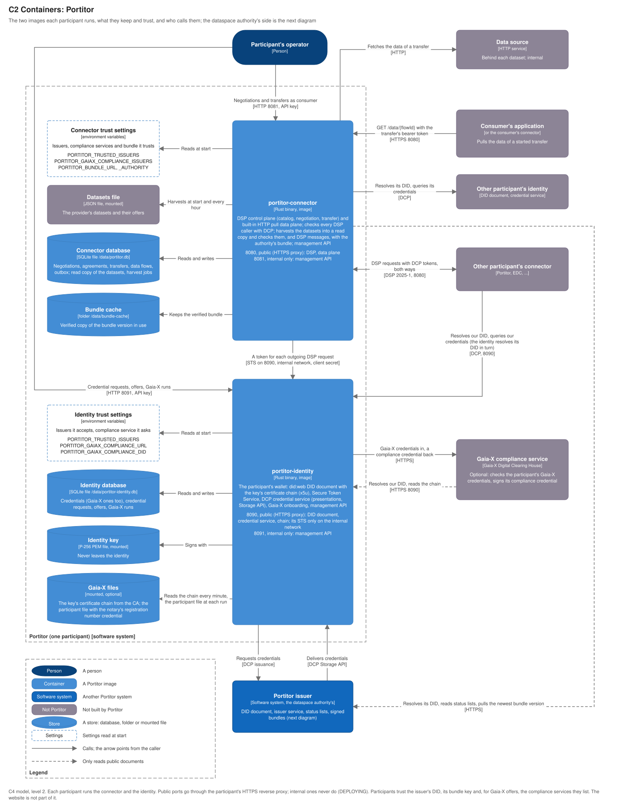

The dataspace authority's side: the issuer, what it keeps, and the bundle
that `portitor-issuer bundle build` signs offline with a key that never
reaches the issuer. The issuer answers the same health checks on its
management port and can send its traces and metrics to the authority's
own observability backend.


**Deployment and flows**: two of the C4 model's supplementary views,
drawn from [DEPLOYING](DEPLOYING.md), the ADRs and the code.

The deployment diagram: one participant's host (its HTTPS reverse
proxy in front of the public ports 8080 and 8090, the STS reached only on
the internal network, the management ports 8081 and 8091 never public
and probed there for health, the `/data` volumes and the mounted keys
and secrets, the optional OpenTelemetry collector), the authority's
host with the issuer (8070 public, 8071 internal) and its bundles folder,
and the offline machine that builds and signs the bundles.


The C2, C3 and deployment diagrams still draw each image's database as
a SQLite file on `/data`. From 1.3 it is a PostgreSQL database outside
the containers, shared by the replicas of an image
([Storage](#storage)); the diagrams are redrawn in 1.3.
<!-- 1.3: check after integration -->

Three dynamic diagrams, as sequences with numbered messages. Joining a
dataspace: the authority registers the participant's DID, the identity
asks the issuer for a `MembershipCredential` and the issuer delivers it
to its Storage API ([ADR 0018](adr/0018-issuer-component.md)); then the
connector proves membership to a verifier.

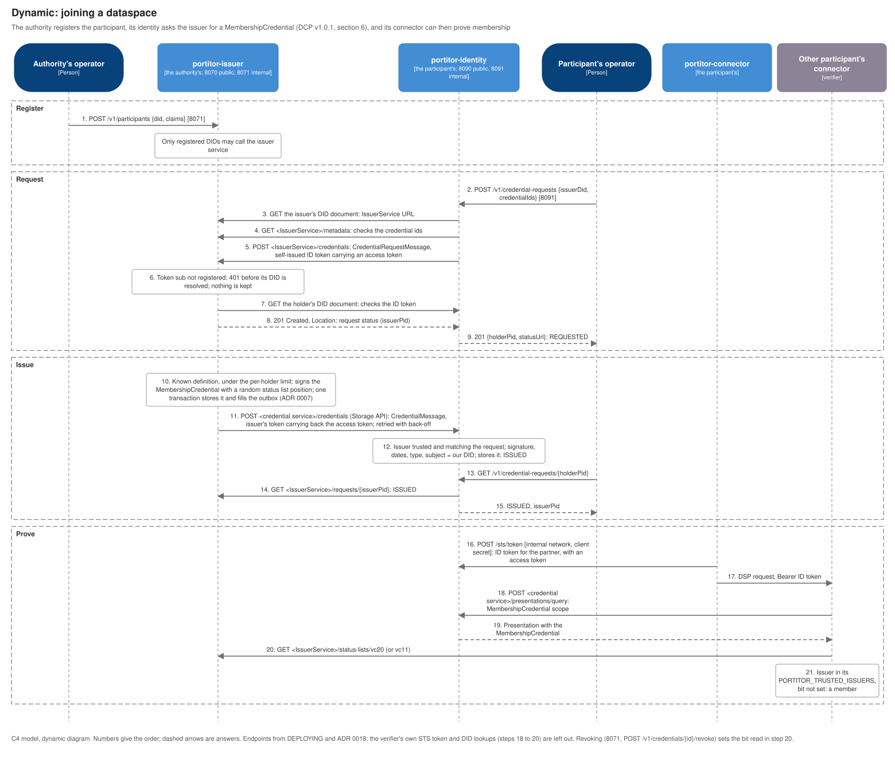

Negotiating and transferring: the catalog, the DCP check of a caller,
the contract negotiation to `FINALIZED` and a pull transfer whose data
address the consumer's application uses at `/data/{flowId}` (ADRs
[0007](adr/0007-outbox-and-proof-of-delivery.md),
[0013](adr/0013-transfer-and-data-plane.md),
[0014](adr/0014-transfers-as-consumer.md),
[0016](adr/0016-dsp-caller-authentication.md),
[0019](adr/0019-credential-constraints.md)). Its footnote says what 1.1
adds to this flow (the membership checked again, running downloads cut,
the audit line, `s3://` sources); a push transfer is not drawn
([ADR 0027](adr/0027-push-transfers-and-object-storage.md)).

Two APIs carry this flow, and they have different callers. The
**management API** (port 8081, API key, `/v1/...`) is for the operator
of a connector and its own systems; no specification defines it. The
**DSP API** (port 8080, DCP token, `/dsp/2025-1/...`) is for the other
connector; DSP 2025-1 defines it. One management call makes the
connector send one DSP message, so some paths look alike:

| The operator calls its own connector (management) | The connector then calls the other one (DSP) | Steps |
|---|---|---|
| `POST /v1/catalog/request` | `POST /catalog/request` | 1, 3 |
| `POST /v1/catalog/dataset/request` | `GET /catalog/datasets/{id}` | not drawn |
| `POST /v1/negotiations` | `POST /negotiations/request` | 10, 12 |
| `POST /v1/transfers` | `POST /transfers/request` | 19, 20 |
| `POST /v1/transfers/{consumerPid}/completion` | `POST /transfers/{providerPid}/completion` | 29, 30 |
| `POST /v1/transfers/{consumerPid}/termination` | `POST /transfers/{providerPid}/termination` | not drawn |
| `POST /v1/transfers/{consumerPid}/suspension` (1.1) | `POST /transfers/{providerPid}/suspension` | not drawn |
| `POST /v1/transfers/{consumerPid}/start` (1.1) | `POST /transfers/{providerPid}/start` | not drawn |
| `POST /v1/provided-transfers/{providerPid}/termination` (1.1, as provider) | `POST {callback}/transfers/{consumerPid}/termination` | not drawn |

The management call takes no DSP message: the connector builds it,
gets a token and, for a negotiation or a transfer, saves it before
sending (ADR 0007). A catalog request is sent once and not saved. An operator does
not call the other connector's DSP API by hand, because that call must
carry a token that proves it comes from its connector.

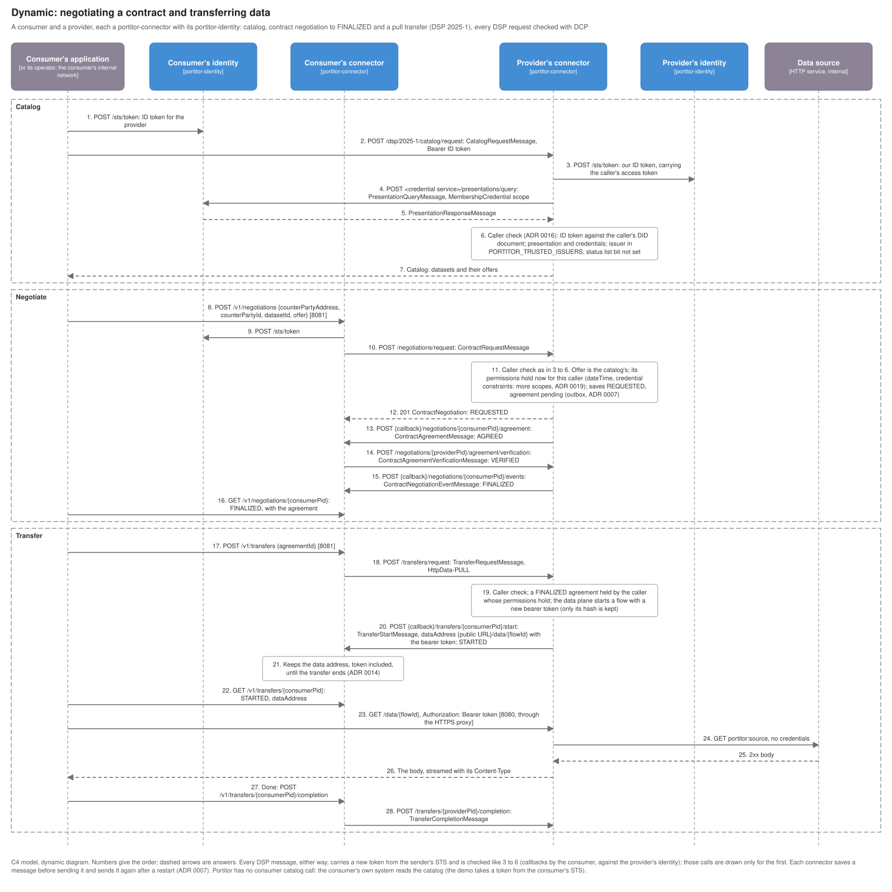

The states of a contract negotiation, as both parties keep them (DSP
2025-1), and the message that moves each one. Gaps between the
specification and what is stored are in the
[negotiation spike](spikes/1.x-negotiation-state-machine.md).


Gaia-X (optional): the identity gets its compliance credential from a
compliance service ([ADR 0021](adr/0021-gaia-x-onboarding.md)), and a
provider checks it for an offer that requires it
([ADR 0022](adr/0022-gaia-x-compliance-in-policies.md)).

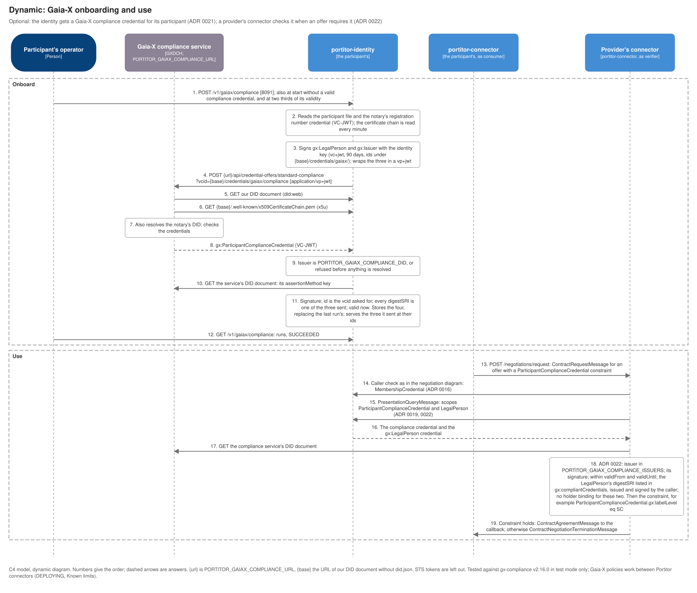

**C3 Components**: inside each image, the adapters around the pure
domain crates ([ADR 0004](adr/0004-hexagonal-architecture.md)). The
shared `portitor-runtime` also holds the health checks (`health.rs`) and
the traces and metrics (`telemetry.rs`) of all three
([ADR 0023](adr/0023-observability.md)). The connector's row of 1.1
components is drawn below its data plane: the push sender, the
receiving route, the running flows and membership gate, the object
storage client and the audit line
([ADR 0027](adr/0027-push-transfers-and-object-storage.md)).

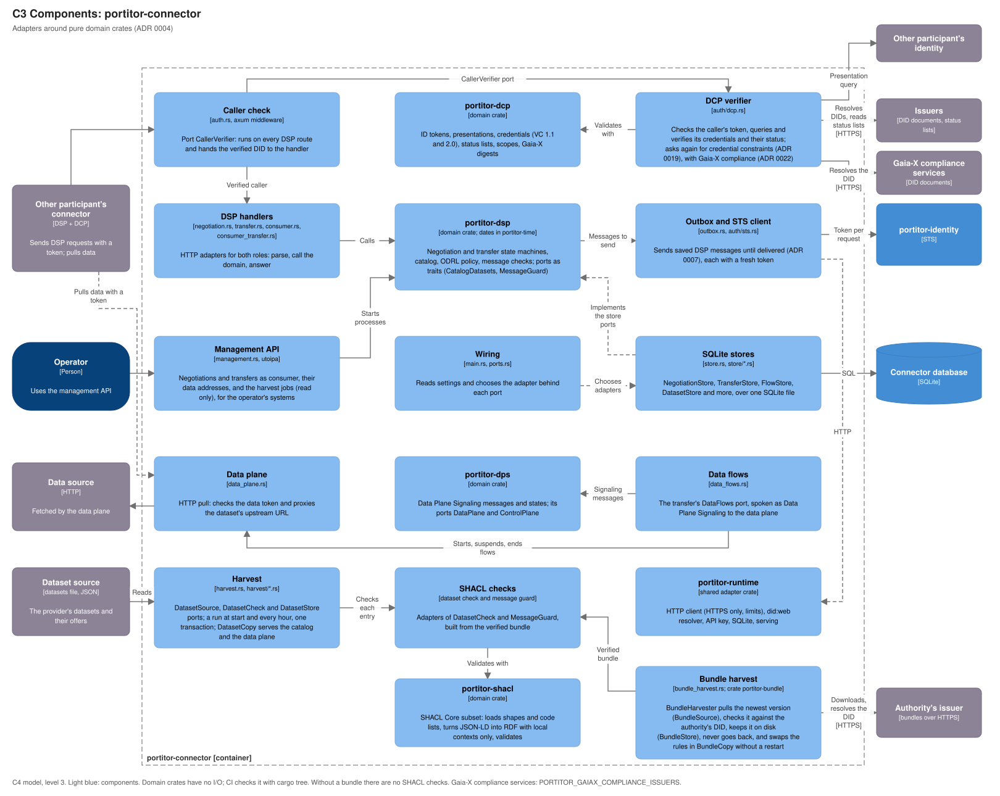

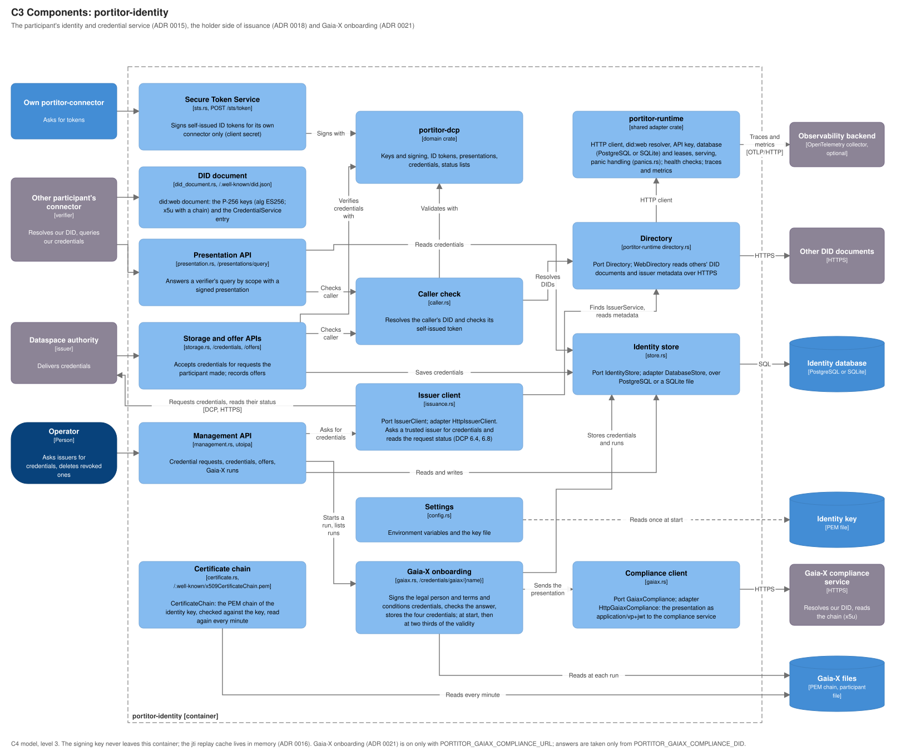

The issuer's components ([ADR 0018](adr/0018-issuer-component.md)),
with the files they live in:


**C4 Code**: nine flows, each drawn as a hexagon: the domain service or
function in the middle, the ports (traits, dashed yellow) it uses, the
adapters behind them, and the HTTP edge that calls it. The names are the
real type, trait, function and file names, so you can search the code
for them. Consumer negotiation and consumer transfers follow the same
pattern and are not drawn. The four services share their steps (receive
with proof of delivery, compare-and-update) through
`portitor-dsp/src/process.rs` (`Record`, `Records`, `update`), named in
the legend of both diagrams.

The provider side of contract negotiation: `ProviderService` in
`portitor-dsp`, behind the DSP handlers of `portitor-connector`.


The provider side of a transfer: `TransferService` checks the agreement,
then starts the data flow through Data Plane Signaling (`portitor-dps`)
on the built-in data plane, which gives the consumer a data address with
a bearer token. Since 1.1 the data plane also holds a `PushJob` for a
push flow, sent by `send` (`push.rs`); it reads `s3://` sources through
`ObjectStorage`, cuts running downloads and pushes through
`RunningFlows`, and checks the consumer's membership again through
`MembershipGate` ([ADR 0027](adr/0027-push-transfers-and-object-storage.md)).
Since 1.2 the data plane is the crate `portitor-dataplane`: the start
message names the dataset's source in its `metadata`
(`portitor:source`), the flow keeps it, and the data plane asks the
control plane's `MembershipGate` through its own port, `AccessGate`
([ADR 0028](adr/0028-separate-pluggable-data-plane.md), step 1).

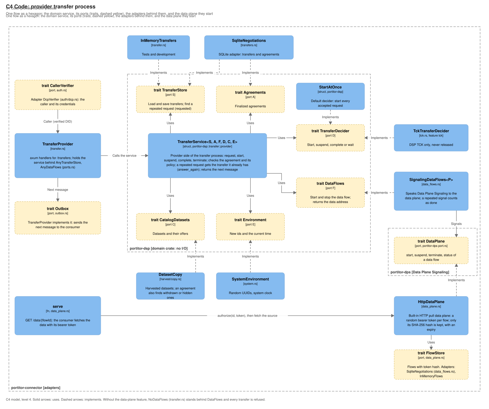

How the management API reads a provider's catalog:
`CatalogReader` gets a token through the `Prover` port, sends one
request through the `Sender` port and hands the provider's answer on as
it came. Nothing is stored and nothing is tried again.

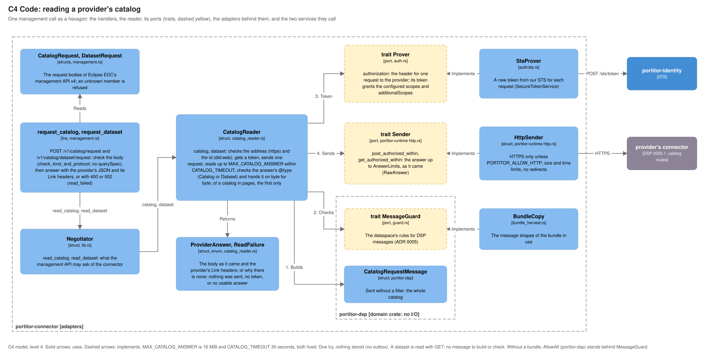

How the connector checks who calls a DSP endpoint with DCP (the caller's
token, its presentations, trusted issuers, status lists), how it checks
Gaia-X compliance credentials and the legal person credentials they name,
and how a policy with credential constraints gets the caller's credentials
([ADR 0016](adr/0016-dsp-caller-authentication.md),
[ADR 0019](adr/0019-credential-constraints.md),
[ADR 0022](adr/0022-gaia-x-compliance-in-policies.md)).

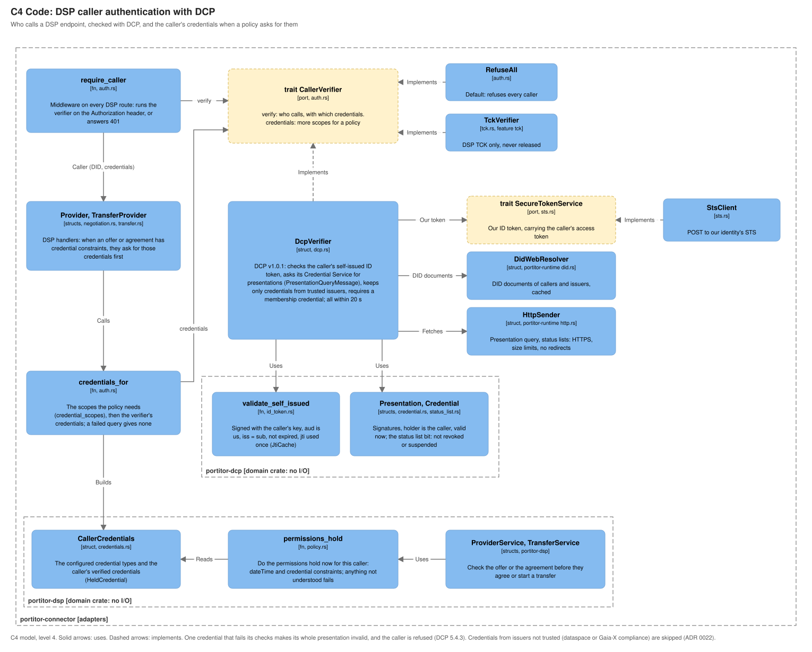

How the issuer takes a credential request, decides it, stores it and
delivers the credentials to the holder through its outbox, and how it
signs its status lists ([ADR 0018](adr/0018-issuer-component.md)).


How the identity component signs tokens for its own connector (STS) and
answers another participant's presentation query; a scope by type `T` also
covers a Gaia-X credential of type `gx:T` ([ADR 0021](adr/0021-gaia-x-onboarding.md)).


How the identity component gets and renews its Gaia-X compliance
credential: it signs the legal person and terms and conditions
credentials with `portitor-dcp`, sends them through the `GaiaxCompliance`
port to a Gaia-X compliance service, checks the answer and stores it
([ADR 0021](adr/0021-gaia-x-onboarding.md)).


How the connector harvests its datasets into a read copy: the source,
a check of each entry, one transaction per run, then the copy that the
catalog and the transfers' start messages read ([ADR 0020](adr/0020-dataset-harvest.md)).


How the authority publishes the schema and vocabulary bundle, and how a
connector loads it: `portitor-issuer bundle build` signs it offline, the
issuer serves it, the connector verifies it through the authority's DID
document and keeps it in a cache ([ADR 0005](adr/0005-schema-and-vocabulary-registry.md)).

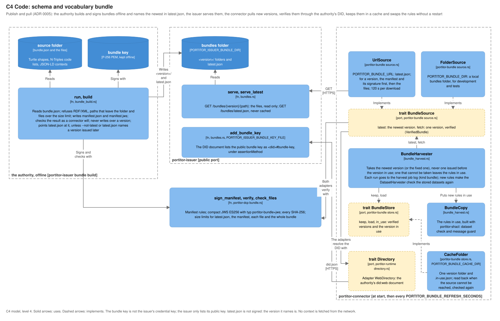

One more C4 Code diagram is not a hexagon but a map of types: where an
offer or an agreement enters Portitor, the types that read it strictly (a
field they do not know is an error, never dropped), and the checks that
rely on that
([ADR 0009](adr/0009-minimal-odrl-policies.md), amendment of 2026-11-18).

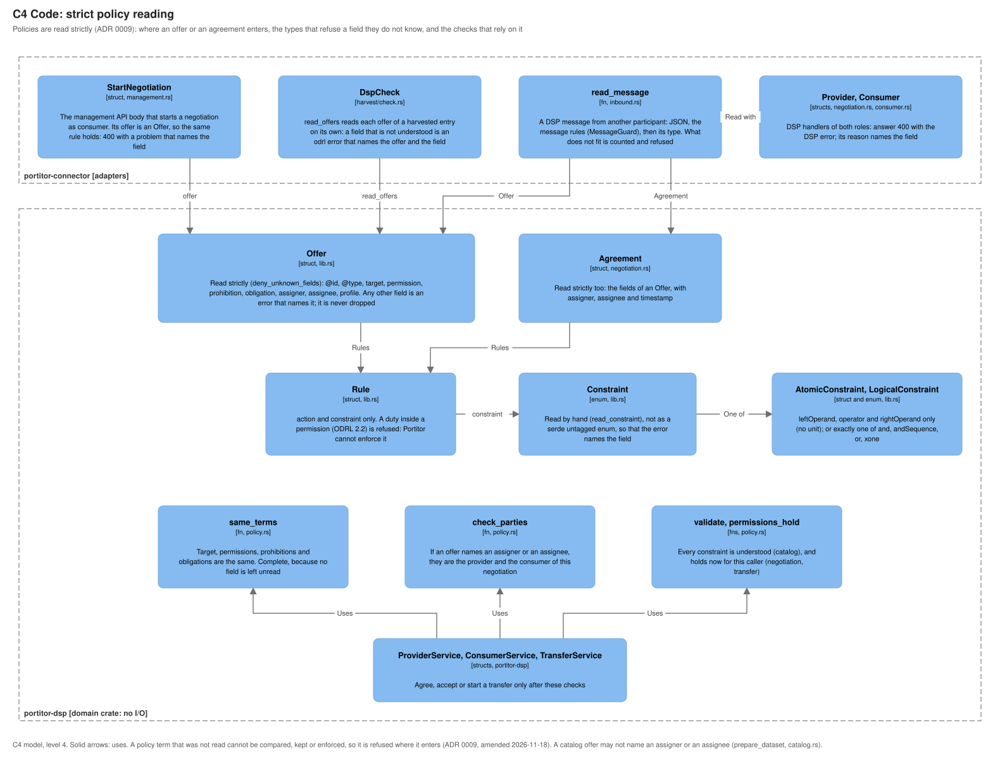

## Who holds the credentials

Every credential in Portitor is held by a **participant**: an
organisation (a legal person) that runs a connector, named by one DID
(`PORTITOR_PARTICIPANT_ID`). The credentials are system to system:

- The identity is the participant's wallet, not a person's. It holds the
  organisation's key, its credentials (for example `MembershipCredential`
  from the dataspace issuer, and with Gaia-X the `gx:LegalPerson` and
  `gx:ParticipantComplianceCredential`) and signs the participant's DCP
  tokens and presentations.
- The issuer registers participants (DIDs), not people, and issues to
  them.
- The connector checks the calling participant on every DSP request
  (control plane) and agrees contracts between participants
  ([ADR 0016](adr/0016-dsp-caller-authentication.md),
  [ADR 0019](adr/0019-credential-constraints.md)).

Portitor does not identify the people or applications inside an
organisation (user to system). The operator's management APIs are
protected by an API key, and the data plane checks the transfer's
bearer token and, since 1.1, that the consumer is still a member
([ADR 0027](adr/0027-push-transfers-and-object-storage.md)): whoever in
the consumer's organisation holds the token gets the data. This is
decided for 1.x ([ADR 0025](adr/0025-users-and-roles.md),
accepted 2026-11-20): users stop at the organisation's own reverse
proxy, and the provider's data plane does not know persons. Whether the
data plane should check more about the caller on each pull is open,
listed as technical debt in
[RISKS_AND_TECHNICAL_DEBTS](RISKS_AND_TECHNICAL_DEBTS.md#td-02) ("Who
calls the data plane, and with which credentials", TD-02; and TD-04, user
to system authentication).

## Components

One mono repo, one version. Each component is a **module** of the mono
repo (a crate in the Cargo workspace) and can ship as its **own image**.

**The split is decided in [ADR 0003](adr/0003-component-split.md):**
three images, split by who runs them and which keys they hold. Each
image keeps its state in its own PostgreSQL database, an external
dependency and not a Portitor image, or, deprecated, in a SQLite file
([Storage](#storage)).

| # | Component (image) | Role | Mandatory? | Protocols |
|---|---|---|---|---|
| 1 | Database: one PostgreSQL database per image (external, not built by Portitor), shared by its replicas; or one SQLite file per image, one process, deprecated since 1.3 | State of negotiations, transfers, credentials | Mandatory | none |
| 2 | `portitor-identity` | Holds the participant's DID, keys and credentials; asks issuers for credentials; answers presentation queries. Optionally it publishes the X.509 chain of its key and gets its Gaia-X compliance credential from a Gaia-X compliance service ([ADR 0021](adr/0021-gaia-x-onboarding.md)) | Mandatory for each participant, unless an external DCP wallet is used. Simpl-Open does not use DCP between participants; how Portitor would join a Simpl-Open data space is in [ADR 0017](adr/0017-simpl-open.md) | DCP (credential service) |
| 3 | `portitor-connector` | Control plane: catalog (datasets harvested into a read copy), contract negotiation, transfer; verifies DCP presentations, including Gaia-X compliance credentials ([ADR 0022](adr/0022-gaia-x-compliance-in-policies.md)); checks datasets and DSP messages against the authority's SHACL shapes. The data plane is its own crate, `portitor-dataplane`, linked into the connector ([below](#data-plane-inside-the-connector-or-separate)) | Mandatory | DSP, DCP (verifier) |
| 4 | `portitor-issuer` ([ADR 0018](adr/0018-issuer-component.md)) | Issues and revokes credentials (for example membership) to the participants the authority registered; publishes their status lists. It also serves the signed schema and vocabulary bundle, which `portitor-issuer bundle build` signs offline ([ADR 0005](adr/0005-schema-and-vocabulary-registry.md)) | Optional: one per dataspace, run by the dataspace authority, never on a participant's host | DCP (issuance) |

### Images and crates

Each release ships three images, built from one `Dockerfile` (one build
target per image) and released, signed and attested together
([RELEASING.md](RELEASING.md)). Each image keeps its state in its own
database ([Storage](#storage)); the drawing shows the SQLite files.

```
 one participant runs both:

   +-----------------------------+        +----------------------------------+
   | portitor-connector          |  (1)   | portitor-identity                |
   | 8080 DSP, data plane        |------->| 8090 DID document, STS,          |
   | 8081 management API,        |  STS   |      credential service,         |
   |      health checks          |        |      certificate chain           |
   | /data/portitor.db           |        | 8091 management API,             |
   | /data/bundle-cache          |        |      health checks               |
   +-----------------------------+        | /data/portitor-identity.db       |
          | (2) DSP request + token       +----------------------------------+
          v                                        ^ (3) DID document,     | (4) Gaia-X
   partner's connector ----------------------------+     presentation      v     credentials
                                                         query       Gaia-X compliance service

 the dataspace authority runs one, for all participants:

   +----------------------------------+
   | portitor-issuer                  |  identities ask it for credentials
   | 8070 DID document, DCP issuer    |  (DCP issuance) and it delivers them
   |      service, status lists,      |  to their Storage API; verifiers
   |      bundles                     |  read its DID document and status
   | 8071 management API,             |  lists; connectors pull the
   |      health checks               |  newest bundle version
   | /data/portitor-issuer.db         |
   +----------------------------------+

 crates (-> means "uses"):

   portitor-connector --> portitor-dsp, portitor-dps, portitor-dcp,
                          portitor-shacl, portitor-bundle,
                          portitor-dataplane, portitor-runtime
   portitor-dataplane --> portitor-dps, portitor-dsp, portitor-runtime
                                                (adapter: the built-in
                                                 data plane, 1.2; never
                                                 the connector)
   portitor-bundle    --> portitor-dcp, portitor-runtime
                                                (adapters: the authority's
                                                 bundle, fetched and kept)
   portitor-identity  --> portitor-dcp, portitor-runtime
   portitor-issuer    --> portitor-dcp, portitor-runtime
   portitor-runtime   --> portitor-dcp, portitor-time
                                                (adapters: HTTP client,
                                                 did:web resolver, API key,
                                                 logging, shutdown, traces
                                                 and metrics (OpenTelemetry),
                                                 health checks, request
                                                 size limits)
   portitor-dps       --> portitor-dsp          (DataAddress)
   portitor-dsp, portitor-dcp --> portitor-time
   portitor-shacl     --> oxrdf, oxttl, oxjsonld (Oxigraph's RDF crates)
                                                (domain crates: no I/O)
```

The three binaries are described in the table above. What the table
does not say:

- `portitor-connector` also holds the management API and its stores. For datasets and the bundle see
  [Datasets and shapes](#datasets-and-shapes).
- `portitor-identity` asks issuers for credentials through the port
  `IssuerClient` (`issuance.rs`, ADR 0018). The X.509 chain of its key
  is in `certificate.rs`, served at
  `/.well-known/x509CertificateChain.pem` and named by `x5u` in the DID
  document; the Gaia-X onboarding is in `gaiax.rs`, behind the port
  `GaiaxCompliance` (ADR 0021; see [Gaia-X](#gaia-x)).
- `portitor-issuer` serves built bundles at
  `GET /bundles/{version}/{path}` and lists the bundle key in its DID
  document.
- `portitor-runtime`: library of adapters the binaries share, so they are
  not copied. Among them the database layer
  (`database.rs`, `database/`; [Storage](#storage)).
- `portitor-dataplane` (1.2): the built-in data plane, linked into the
  connector: HTTP pull, the push sender, object storage, running-flow
  cuts and the audit line. The connector talks to it through the Data
  Plane Signaling `DataPlane` port; it asks the connector through its
  own ports (`AccessGate`, the membership check). It does not depend on
  `portitor-connector`, and CI checks that
  ([ADR 0028](adr/0028-separate-pluggable-data-plane.md), step 1).
- `portitor-bundle`: adapter library for the authority's signed
  bundle on a participant's side: `BundleSource` (download or folder,
  verified) and `BundleStore` (the read copy on disk and the version in
  use). Its own crate so any service can reuse it (maintainer,
  2026-11-14); how schemas are collected and stored is technical debt
  ([TD-01](RISKS_AND_TECHNICAL_DEBTS.md#td-01)).
- `portitor-dsp`, `portitor-dps`, `portitor-dcp`, `portitor-time`: domain
  crates (ADR 0004); CI checks they have no I/O dependency.
- `portitor-shacl`: our own SHACL Core subset (ADR 0005), a domain
  crate too: no I/O, no network. Shapes that use a SHACL term it does not
  implement are refused when they are loaded.

### How a DSP call is authenticated

The numbers are those of the drawing above (DCP v1.0.1): (1) the connector asks its own identity's STS for
a self-issued ID token addressed to the partner; (2) it sends that token
with its DSP request; (3) the partner's connector checks the token against
the participant's DID document and queries the participant's credential
service for the credentials it needs. The connector never holds the
participant's private key. (4) With Gaia-X on, the identity sends the
participant's Gaia-X credentials to a compliance service and keeps the
compliance credential it gets back (see [Gaia-X](#gaia-x) below).

In the connector (ADR 0016) this is two ports in `auth.rs`, with their DCP
adapters in `auth/dcp.rs` and `auth/sts.rs`:

- `CallerVerifier`, run by a middleware on every DSP route (provider
  endpoints and consumer callbacks; not `/.well-known/dspace-version`,
  `/health` or the data plane). The DCP adapter reads the
  `Authorization: Bearer` ID token, resolves the caller's `did:web` DID
  (a DID document is reused for `PORTITOR_DID_CACHE_SECONDS`, in every
  component),
  validates the token (`portitor_dcp::validate_self_issued`: key with
  `capabilityInvocation`, `aud` = our DID, `iss` = `sub`, `exp`/`iat`/`nbf`,
  `jti` not replayed), then sends a `PresentationQueryMessage` for
  `PORTITOR_DCP_SCOPES` to the caller's credential service, with a token
  from our STS that carries the caller's access token. It verifies every
  presentation and credential (both profiles), fetches and verifies each
  status list credential (signed by the credential's issuer, fail closed;
  a verified list is reused for `PORTITOR_STATUS_LIST_CACHE_SECONDS`),
  and requires a `MembershipCredential` from a trusted issuer about the
  caller (each credential signed with a key of its issuer's own DID,
  DCP v1.0.1, 5.4.3, step 4). One credential that fails its checks makes its presentation
  invalid and refuses the caller (DCP v1.0.1, 5.4.3, step 8). The verified DID and credentials go to the handler as `Caller`;
  a refusal is a DSP error with no detail: HTTP 404 on the negotiation
  and transfer routes, HTTP 401 on the catalog routes (ADR 0016). When an offer or
  agreement has credential constraints (ADR 0019), the provider's handler
  derives their scopes (`portitor_dsp::policy::credential_scopes`) and
  asks the verifier again (`CallerVerifier::credentials`): a second query,
  with the access token the caller sent; the domain evaluates the policy
  with the result.
- `Prover`, used by the outbox before each outgoing DSP request: a fresh
  token from our STS with `aud` = the counter-party's DID (stored with the
  negotiation or transfer when it started, never taken from an incoming
  message) and `bearer_access_scope` = `PORTITOR_DCP_SCOPES`, plus, for a
  contract request, an acceptance or a transfer request, the scopes of the
  offer's or agreement's credential constraints. Tokens are not cached:
  each `jti` is accepted once.

The domain binds each negotiation and transfer to its counter-party: as
provider, only the DID that started it may send to or read it; as
consumer, only the provider it was started with may use its callbacks. At
start the connector resolves its own DID document and checks that its STS
signs for it. Tests use fake ports; the `tck` build maps the DSP TCK's
fixed header to the TCK participant.

### Storage

Each image keeps its state in one database, behind its store ports
([ADR 0004](adr/0004-hexagonal-architecture.md)). The database layer
is in `portitor-runtime` (`src/database.rs` and `src/database/`;
[ADR 0029](adr/0029-several-replicas.md)):

- **Two databases.** PostgreSQL, shared by every replica of the
  image, one database per image. Or a SQLite file, one process per
  file, deprecated since 1.3 and removed in 2.0. The setting
  (`PORTITOR_DATABASE_URL` or `PORTITOR_DB_FILE`) chooses
  ([DEPLOYING, Database](DEPLOYING.md#database)).
- **One SQL text.** A store writes each statement once, with `$1`,
  `$2` placeholders, which the layer rewrites for SQLite. Values go in
  and come out as `Value` (text, whole number, bytes, null). Only the
  schema differs: each image has a migration list per database. The
  PostgreSQL list starts with the 1.3 schema as one baseline, and a
  test keeps the two schemas equal.
- **Transactions.** A write of several statements is one transaction.
  On PostgreSQL it runs at the `SERIALIZABLE` level; when PostgreSQL
  answers that two transactions collided (SQLSTATE `40001` or
  `40P01`), it runs again, up to 10 times. So a store sees "one writer
  at a time", as it did with SQLite's single connection, and the
  compare-and-update writes of
  [ADR 0007](adr/0007-outbox-and-proof-of-delivery.md) keep their
  meaning.
- **Synchronous ports.** A store call waits on the calling thread.
  On PostgreSQL, a database thread of its own drives the connections
  with `tokio-postgres`
  ([TD-40](RISKS_AND_TECHNICAL_DEBTS.md#td-40)). TLS, unless the
  operator turns it off, always checks the server's certificate and
  host name.
- **Migrations** run at start, forward only, in one transaction under
  a PostgreSQL advisory lock: replicas that start together migrate
  once. The table `portitor_schema` names the image that owns the
  database and its schema version; another image refuses it.
- **Coordination.** Processes coordinate only through the database:
  compare-and-update writes, rows written once
  (`INSERT ... ON CONFLICT DO NOTHING`, for used token ids), and leases
  of 30 seconds on work that runs (outbox messages, pushes, uploads,
  scheduled jobs, deliveries, a transfer's data plane step). What 1.3
  changed, item by item, is in ADR 0029, decision 6.
<!-- 1.3: check after integration -->

### Gaia-X

Gaia-X does not use DCP, so the two Gaia-X parts sit next to the DCP
code ([ADR 0021](adr/0021-gaia-x-onboarding.md),
[ADR 0022](adr/0022-gaia-x-compliance-in-policies.md); C2, C3 and C4
diagrams above):

- Identity, onboarding. With `PORTITOR_GAIAX_COMPLIANCE_URL` set, the
  identity signs the participant's `gx:LegalPerson` and `gx:Issuer`
  credentials with its own key (`portitor_dcp::gaiax_sign`), wraps them
  with the notary's registration number credential in a `vp+jwt`, and
  sends it to a Gaia-X compliance service through the `GaiaxCompliance`
  port (`HttpGaiaxCompliance`: `POST {url}/api/credential-offers/standard-compliance`).
  It checks the `gx:ParticipantComplianceCredential` it gets back (issued
  by `PORTITOR_GAIAX_COMPLIANCE_DID`, checked before that DID is
  resolved; the service's signature; the id asked for; the `digestSRI`
  of each credential sent) and stores the four credentials, so the presentation
  API returns them like any other credential. A run happens at start
  without a valid compliance credential, then at two thirds of its
  validity, and on `POST /v1/gaiax/compliance`; runs are kept in the
  table `gaiax_run`. The compliance service reads the identity's DID
  document and, through `x5u`, the certificate chain; for a DID with a
  path, the chain and the credentials are served below that path.
- Connector, policies. A policy may name
  `ParticipantComplianceCredential.<claim path>` as a left operand. The
  DCP verifier accepts that credential only from a service in
  `PORTITOR_GAIAX_COMPLIANCE_ISSUERS`, and only with the `gx:LegalPerson`
  credential it names by `digestSRI`, issued and signed by the caller,
  and with a `validUntil`. A compliance credential from a service not
  listed is skipped, like a credential from an untrusted issuer, so the
  caller can still use offers that need only other credentials. Policies
  see Gaia-X credentials only by their Gaia-X type.

### Datasets and shapes

These ports carry the datasets and the authority's bundle, each with its
adapters (ADR 0004; C4 diagrams above):

- `DatasetSource` (`harvest/source.rs`): a full snapshot of the
  provider's datasets. `FileSource` reads `PORTITOR_DATASETS_FILE` again
  at each run; later sources (a DCAT-AP endpoint, CKAN) are new adapters.
- `DatasetCheck` (`harvest/check.rs`): checks one entry. `DspCheck` holds
  the DSP catalog and ODRL rules; `BothChecks` runs it and then, with a
  bundle that has dataset shapes, `ShaclDatasetCheck` (`shacl.rs`): the
  entry, read with the DSP context only (as the catalog serves it), is
  validated against the shapes for its `dct:accessRights` value.
- `DatasetStore` (`harvest.rs`): the stored datasets, the jobs and
  their errors, in the connector's database (`store/harvest.rs`). A run
  commits in one transaction. `StoredCatalog` (`harvest/catalog.rs`) is
  what the DSP code (`CatalogDatasets`) and `SignalingDataFlows`
  (`UpstreamSources`, `data_flows.rs`) read: from 1.3 the catalog and
  each dataset they need are read from the database on each request, as
  EDC reads its asset index, so every replica answers from the same
  datasets and sees a run as soon as it is committed (ADR 0029, D4).
  Since 1.2 the data plane does not read them: each start message names
  the dataset's source, and the flow keeps it until it ends.
- `BundleSource` (`portitor-bundle`, `source.rs`): the authority's bundles. It names
  the newest version (`latest.json`) and gives one version, verified.
  `UrlSource` downloads over HTTPS; `FolderSource` reads a local folder.
  Both check the signature against the authority's `did:web` document
  and every digest.
- `BundleStore` (`portitor-bundle`, `store.rs`): the read copy of the bundle on
  disk and the version in use. `CacheFolder` keeps one version folder
  and `.in-use.json`, in each container. From 1.3 the connector's
  version in use is the one in its database (`SharedBundleVersion`,
  `store/bundle_in_use.rs`; TD-55): a process that takes a new version
  records it there, and every process moves to it at start and then
  every 5 seconds (`BundleHarvester::follow`).
- `BundleHarvester` (`bundle_harvest.rs`) takes the configured version
  at start and looks for a newer one on a schedule, the bundle side of
  `DatasetHarvester`. It never takes a version issued before the one in
  use. `BundleCopy` holds the rules in use; it is the `DatasetCheck` and
  `MessageGuard` the connector uses with a bundle, and a new version
  replaces its rules without a restart. Its runs go to the harvest job
  log (kind `bundle`), and a new version makes the `DatasetHarvester`
  check the stored datasets again.

DSP messages are checked through the `MessageGuard` port of
`portitor-dsp` (`guard.rs`). With a bundle that has `messages` shapes,
`ShaclGuard` (`shacl.rs`) checks negotiation and transfer messages in
(before they are processed; a refusal is answered 400) and out (before
they are sent; a refused message is not sent and its process ends);
otherwise `AllowAll` lets every message through. Incoming catalog
requests are not checked; the `CatalogRequestMessage` the connector
sends for the management API's catalog call is
(`catalog_reader/request.rs`).
The catalog's `@context` is always the DSP 2025-1 context alone,
with or without a bundle; the bundle's `context` files only serve to
read messages whose `@context` names their URL.

State: the source of truth for datasets lives outside the connector. The
read copy is rebuilt from the source by the next run, and the bundle
cache from the authority's issuer; neither is a place where datasets or
shapes are edited. No API writes datasets or policies.

The website is a static site published by GitHub Pages; it is not deployed
by participants.

## Deployment order

Once per dataspace, by the dataspace authority, the party that applies
the dataspace's Governance Framework (DSP 2025-1 term):

First, decide what DCP leaves to the dataspace: trusted issuers, scope
strings and holder binding, and, if used, Gaia-X compliance and the
dataset metadata bundle
([DEPLOYING.md](DEPLOYING.md#what-the-dataspace-decides-first)). Then:

1. Issuer (`portitor-issuer`): its own database, key and `did:web`
   document; its credential definitions; then register each participant
   (DID and claims) through its management API.
   If the dataspace checks dataset metadata: build and sign the
   schema and vocabulary bundle offline with `portitor-issuer bundle
   build`, list the bundle key in the issuer's DID document
   (`PORTITOR_ISSUER_BUNDLE_KEY_FILE`) and publish the bundle folder
   (`PORTITOR_ISSUER_BUNDLE_DIR`).

Then for each participant:

2. Storage: a PostgreSQL database and user for each image
   ([DEPLOYING, Database](DEPLOYING.md#database)).
3. Identity (`portitor-identity`): publish the `did:web` document over
   HTTPS, then ask the issuer for a membership credential (DCP issuance).
   For Gaia-X: get a certificate for the identity key and the
   notary's registration number credential, write the participant file,
   and set the compliance service's URL; the identity then gets and
   renews the compliance credential itself.
4. Connector (`portitor-connector`): point it at the identity and the
   database, trust the issuer's DID, give it its datasets file and, with
   a bundle, the bundle's URL, version and authority. Offers that require
   Gaia-X compliance also need the trusted compliance services
   (`PORTITOR_GAIAX_COMPLIANCE_ISSUERS`).

## Data plane: inside the connector or separate?

**Decided (maintainer, 2026-11-11): option A, inside the connector,
behind an internal interface that follows Eclipse Data Plane Signaling.**
This section is the record of that decision; the debt it leaves is
[TD-17](RISKS_AND_TECHNICAL_DEBTS.md#td-17).

**What each part does.** The control plane negotiates: catalog, contract,
and the start and end of a transfer (DSP). The data plane moves the bytes,
for example by serving a file over HTTP to the consumer, with a short-lived
token that the control plane issued.

**Option A: in the connector's process (decided).** The data plane
is its own module, but runs inside the connector's process and image: one
deployment step. No internal API to secure or version. The cost:
the data traffic and the protocol logic share CPU, memory and the network
exposure; you cannot scale them apart; a bug in data handling can take down
negotiation.

**Option B: separate data plane service.** Scales and fails independently,
can sit in another network zone near the data, and allows several data
plane types (HTTP, S3, Kafka). The cost: a fourth component, and an
internal control-to-data-plane API. DSP does not define that API. The
Eclipse Data Plane Signaling spec does, but it is still incubating with no
release. EDC is moving to Data Plane Signaling (Simpl-Open's connector
is built on EDC, [ADR 0017](adr/0017-simpl-open.md)), so building our own
interface now risks rework.

**Decision.** Option A, with the data plane behind an internal interface
that follows Eclipse Data Plane Signaling v1.0-RC4
([Specification versions](#specification-versions)): the same data flow
state machine, the same messages (`prepare`, `start`, `started`,
`suspend`, `resume`, `terminate`, `completed`, `errored`) and the same
`DataAddress` shape. In-process, these are function calls. The HTTP
endpoints (`/dataflows/...` on the data plane,
`/transfers/:id/dataflow/...` on the control plane) are added only when
the data plane is split out, which is not in 1.0
([STABILITY](STABILITY.md#what-10-does-not-do)). We track the
specification until its 1.0 release and record each update in the
changelog ([R-06](RISKS_AND_TECHNICAL_DEBTS.md#r-06)). Interoperability
with EDC and Simpl-Open is not affected either way: other connectors see
only DSP and the data endpoint, never our internal split.

Since 1.1 the built-in data plane also pushes over HTTP and reads
S3-compatible object storage, still inside the connector's process
([ADR 0027](adr/0027-push-transfers-and-object-storage.md)).
[ADR 0028](adr/0028-separate-pluggable-data-plane.md) (2026-11-25) plans
to make it a data plane like any other, over Data Plane Signaling. Its
step 1 is done in 1.2: the data plane is the crate `portitor-dataplane`,
still linked into the connector, and it reads none of the control
plane's stores. CI checks with `cargo tree` that it does not depend on
`portitor-connector`.

**In code.** The domain crate `portitor-dps` holds the signaling
messages, the data flow state machine and two ports: `DataPlane` (what the
control plane asks: `prepare`, `start`, `started`, `suspend`, `resume`,
`terminate`, `completed`, `status`) and `ControlPlane` (what the data plane
reports: `prepared`, `started`, `completed`, `errored`). The optional
agreement retrieval endpoint and registration are left out: one built-in
data plane needs neither.

Implementing v1.0-RC4 and running the DSP TCK v1.0.2 showed errors and
gaps in both. They are reported upstream; the list, with what Portitor
does meanwhile, is in
[RISKS_AND_TECHNICAL_DEBTS, "Upstream reports"](RISKS_AND_TECHNICAL_DEBTS.md#upstream-reports)
(reports 2 to 6), and the choices they forced are in
[ADR 0013](adr/0013-transfer-and-data-plane.md) and
[ADR 0014](adr/0014-transfers-as-consumer.md).
