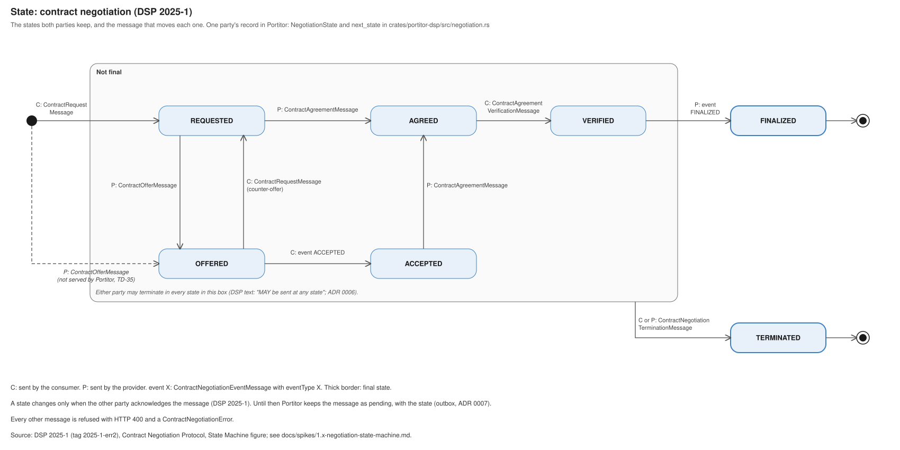

<!--
SPDX-FileCopyrightText: Portitor contributors

SPDX-License-Identifier: Apache-2.0
-->

# Spike: the contract negotiation state machine in DSP terms

Date: 2026-11-25. A research spike: no change to the code. Read
against `main` at `ef7f4ca` (1.1.0 close-out). Specification: DSP
2025-1, tag `2025-1-err2` (commit `d7d810b`),
`specifications/negotiation/contract.negotiation.protocol.md` and
`contract.negotiation.binding.https.md`. Compared with Eclipse EDC
`v1.0.0-RC8` (commit `2a5e560`, 2026-11-19), the latest EDC tag on
2026-11-25.

## The question

Roadmap, "Research before code" (maintainer, 2026-11-21): write out the
contract negotiation state machine in DSP terms, every state and every
transition, and check that the stored data matches it.

**Result.**

- The states and transitions in the code are the DSP ones, one to one.
  A test already checks every (state, message, sender) against the DSP
  figure.
- What is stored per negotiation holds together. An experiment drove
  a provider and a consumer against each other through every order of
  delivery, lost answer and lost message, 3,869 distinct stored
  situations. No stored record broke a rule (for example, `AGREED`
  without an agreement).
- Seven gaps, none of them a break of the DSP state machine. The one
  that matters most: **a first contract request sent again (its answer
  got lost) starts a second negotiation on the provider.** EDC RC8 does
  not do this. Transfers already handle the same case (TD-34).
- No ADR is needed for the two small fixes. One gap (two sides that end
  in different states and never find out) is kept as in EDC and
  recorded as TD-49.

## 1. The states

DSP: "A Contract Negotiation transitions to a state in response to an
acknowledged Message from the counter-party. Both parties have the same
state." Each state is named after the message that leads to it.

| DSP state | DSP meaning (shortened) | Message that leads to it | Sent by | Terminal |
|---|---|---|---|---|
| `REQUESTED` | The consumer asked for an agreement on an offer; the provider acknowledged | `ContractRequestMessage` | Consumer | no |
| `OFFERED` | The provider sent an offer; the consumer acknowledged | `ContractOfferMessage` | Provider | no |
| `ACCEPTED` | The consumer accepted the latest offer; the provider acknowledged | `ContractNegotiationEventMessage`, `eventType` `ACCEPTED` | Consumer | no |
| `AGREED` | The provider sent an agreement; the consumer acknowledged | `ContractAgreementMessage` | Provider | no |
| `VERIFIED` | The consumer verified the agreement; the provider acknowledged | `ContractAgreementVerificationMessage` | Consumer | no |
| `FINALIZED` | The provider sent the finalization; the consumer acknowledged. Data is now available | `ContractNegotiationEventMessage`, `eventType` `FINALIZED` | Provider | yes |
| `TERMINATED` | Either party sent a termination; the other acknowledged | `ContractNegotiationTerminationMessage` | Either | yes |

In the code: `NegotiationState` in
`crates/portitor-dsp/src/negotiation.rs`, stored as the DSP name
(`REQUESTED` ... `TERMINATED`) in the `state` column.

## 2. The transitions

From the DSP figure (`figures/contract.negotiation.state.machine.puml`),
with termination read from the text ("The message MAY be sent at any
state"), as decided in [ADR 0006](../adr/0006-negotiation-storage.md)
(amended 2026-11-18).

| From | Message | Sender | To | Where it happens in Portitor |
|---|---|---|---|---|
| (none) | `ContractRequestMessage` | Consumer | `REQUESTED` | Consumer: management `POST /v1/negotiations`. Provider: `POST /negotiations/request` |
| (none) | `ContractOfferMessage` | Provider | `OFFERED` | **Not served** ([TD-35](../RISKS_AND_TECHNICAL_DEBTS.md#td-35)) |
| `REQUESTED` | `ContractOfferMessage` | Provider | `OFFERED` | Only with a provider decider that offers (the TCK's); the default agrees |
| `REQUESTED` | `ContractAgreementMessage` | Provider | `AGREED` | Default provider path |
| `OFFERED` | `ContractRequestMessage` | Consumer | `REQUESTED` | Counter-offer; only with a consumer decider that asks (the TCK's). A counter-offer with other terms ends the negotiation ([ADR 0009](../adr/0009-minimal-odrl-policies.md)) |
| `OFFERED` | `ContractNegotiationEventMessage` `ACCEPTED` | Consumer | `ACCEPTED` | Default consumer path |
| `ACCEPTED` | `ContractAgreementMessage` | Provider | `AGREED` | Default provider path |
| `AGREED` | `ContractAgreementVerificationMessage` | Consumer | `VERIFIED` | Default consumer path |
| `VERIFIED` | `ContractNegotiationEventMessage` `FINALIZED` | Provider | `FINALIZED` | Default provider path |
| any non-terminal | `ContractNegotiationTerminationMessage` | Either | `TERMINATED` | Either side, by its decider or when a message cannot be delivered |

Everything else is refused with HTTP 400 and a
`ContractNegotiationError`. `next_state` in `negotiation.rs` is this
table; the test `state_machine_matches_the_specification` checks all
8 × 7 × 2 combinations against it.

## 3. What is stored

Two tables in the connector's SQLite file
(`crates/portitor-connector/src/store.rs`), one per role, as EDC keeps
one per negotiation with a `type` column.

| Column | Provider table `negotiation` | Consumer table `consumer_negotiation` |
|---|---|---|
| Key | `provider_pid` (ours) | `consumer_pid` (ours) |
| Other party's pid | `consumer_pid` | `provider_pid`, empty until the provider's first answer |
| `state` | DSP state | DSP state |
| Where messages go | `callback_address` | `provider_address` |
| Other party | `counter_party` (its DID, from its token) | `provider_id` (its DID) |
| `offer` | The latest offer, DSP JSON | The latest offer, DSP JSON |
| `agreement` | Once the consumer acknowledged it, DSP JSON | Once received, DSP JSON |
| `pending` | Our message on its way (the outbox, [ADR 0007](../adr/0007-outbox-and-proof-of-delivery.md)) | Same |
| `version` | Compare-and-update | Same |

How a step is stored: the state changes only when the other party
acknowledges our message, as DSP says. Until then the message waits in
`pending` with the state it leads to. So "`state` + `pending`" is the
whole picture. EDC models the same moment with extra internal states
(`REQUESTING`, `AGREEING`, ...). On the wire EDC reports the target
state; Portitor reports the current one, closer to the DSP text.

| EDC RC8 internal state | Portitor stored |
|---|---|
| `INITIAL`, `REQUESTING` | Consumer: `REQUESTED` + pending first request (see gap G4) |
| `OFFERING` | Provider: `REQUESTED` + pending offer |
| `ACCEPTING` | Consumer: `OFFERED` + pending `ACCEPTED` event |
| `AGREEING` | Provider: `REQUESTED` or `ACCEPTED` + pending agreement |
| `VERIFYING` | Consumer: `AGREED` + pending verification |
| `FINALIZING` | Provider: `VERIFIED` + pending finalization |
| `TERMINATING` | Either: current state + pending termination |

## 4. Compared with EDC RC8

| Topic | EDC RC8 | Portitor 1.1 |
|---|---|---|
| States | 7 DSP states + 8 internal (`ContractNegotiationStates`) | 7 DSP states + `pending` |
| Who may terminate | Every state but `FINALIZED` (`canBeTerminated`) | Every non-terminal state (same, ADR 0006) |
| A message cannot be delivered | Retries, then `TERMINATING`; the first request goes straight to `TERMINATED` (`NegotiationProcessorsImpl`, `onFinalFailure`) | Same: retries, then termination; a first request ends without a message |
| A termination gets no answer | `TERMINATED` anyway | `TERMINATED` anyway (DSP: "MAY choose to ignore the error") |
| A first request sent again | Answered with the negotiation it already started (`findRequestedBy`: consumer pid + counter-party) | **Starts a second negotiation** (G1) |
| Asks the other party for a negotiation's state | Never (no outbound `GET` in its DSP dispatcher) | Once, when a send fails (status check) |
| Why it ended | `error_detail` column | Not stored (G5) |
| Timestamps | `created_at`, `updated_at`, `state_timestamp` | None (G6) |
| Offers | All offers, `contract_offers` list | The latest only (G7) |
| Agreements | Own table `edc_contract_agreement`, with `retired` since RC8 | Inside the negotiation row; looked up by an index on its `@id` |

Sources: `spi/control-plane-spi/.../ContractNegotiationStates.java`,
`.../ContractNegotiation.java`,
`core/control-plane/control-plane-contract/.../NegotiationProcessorsImpl.java`,
`core/control-plane/control-plane-aggregate-services/.../ContractNegotiationProtocolServiceImpl.java`,
`extensions/control-plane/store/sql/contract-negotiation-store-sql/src/main/resources/contract-negotiation-schema.sql`.

## 5. The check

An experiment, not committed: a test in `portitor-dsp` that runs the
real provider and consumer services (the domain, with in-memory stores)
against each other. From the consumer's first request it tries every
next step, depth first, up to 14 steps, for each of 20 pairs of provider
and consumer behaviours (agree, offer first, counter-offer, terminate at
each state). A step is one of: deliver the pending message and record
the answer; deliver it but lose the answer (it is sent again later);
lose it (the outbox gives up, as in `outbox.rs`: status check, then
terminate). The SQLite adapter stores the same fields one to one, so
the in-memory records stand for the rows.

After every step it checks each stored record:

1. `AGREED`, `VERIFIED` or `FINALIZED` has an agreement.
2. A terminal state has no pending message.
3. A pending message leads to the state `next_state` gives for it.
4. A consumer record without a provider pid is waiting for its first
   answer, or ended.
5. When both sides hold an agreement, it is the same one.

And when nothing is left to send, that both sides are in the same state.

**Results** (3,869 distinct situations, 0.4 s):

- Checks 1 to 5 held everywhere.
- Without a lost message, both sides always ended in the same state.
- With lost messages, they can end in different states and stay so
  (G3).
- A lost answer to the first request gave the provider two or three
  negotiations for one consumer negotiation (G1).

The test and its output are kept with the project's files for the
follow-up; it can become a regular test (next steps).

## 6. Gaps

None of these breaks the DSP state machine. They are about duplicates,
divergence after failures, and what an operator can read from the file.

**G1. A repeated first request starts a second negotiation. Medium.**
The outbox sends a first request up to 4 times when no answer comes
([OPERATING](../OPERATING.md)). If the provider handled it but its
answer was lost, the next try has no `providerPid`, so the provider
starts a second negotiation. The consumer keeps the last provider pid;
the first one is an orphan that sends its agreement to a consumer that
refuses it. It ends `TERMINATED`, or `AGREED` for ever (G2). No data
flows (a transfer needs `FINALIZED`), but the file holds negotiations
and agreements nobody uses. DSP has no idempotency rule for contract
requests (it has one for transfer requests: "Providers SHOULD implement
idempotent behavior ... based on the value of `consumerPid`"). EDC RC8
answers a repeated first request with the negotiation it already
started, found by consumer pid and counter-party. Portitor does the
same for transfers since 0.12 ([TD-34](../RISKS_AND_TECHNICAL_DEBTS.md#td-34)).
Fix: the same lookup for negotiations, with an index on
`(counter_party, consumer_pid)`. Small.

**G2. "It arrived before" compares the state only. Low.**
When a message is refused, the outbox asks the other party for its
state and counts the message as delivered if the state is the one it
leads to (`reached` in `negotiation.rs` and `consumer.rs`). It does not
check the process ids in that answer. With G1, an orphan provider
negotiation can count its agreement as delivered because the consumer's
other negotiation is `AGREED`. Fix: also compare `providerPid` and
`consumerPid`. Small.

**G3. After a failure, the two sides can stay in different states. Medium.**
When the other party is unreachable through all tries, we terminate
locally; when our termination is not answered, we stop trying. The
other side may never hear of it and waits for ever, for example a
consumer in `VERIFIED` while the provider is `TERMINATED`, or a
provider in `AGREED` while the consumer is `TERMINATED`. DSP says: "In
case the states differ, the Contract Negotiation MUST be terminated."
Nothing in Portitor finds such a difference later, and a waiting record
never ends. No data leaks: the provider gives data only for a
`FINALIZED` negotiation. EDC RC8 behaves the same: it gives up the
same way (`onFinalFailure`, then `TERMINATING` or `TERMINATED`), and it
never asks the other party for a negotiation's state. Its DSP
dispatcher (`DspNegotiationHttpDispatcherExtension`) registers only the
six `POST` messages; `ContractNegotiationRequestMessage` is used only to
answer another party's `GET`. Portitor already asks once, when a send
fails (the status check of G2).

**Decided** (maintainer, 2026-11-26): document the gap and keep the
behaviour as in EDC ([TD-49](../RISKS_AND_TECHNICAL_DEBTS.md#td-49), Accepted).

**G4. The consumer stores `REQUESTED` before the provider answers. Low.**
DSP defines `REQUESTED` as "the provider has sent an ACK". The consumer
writes `REQUESTED` with the first request still pending, so the
management API shows `REQUESTED` with no `providerPid` for a request
the provider may never get. EDC stores `REQUESTING` here but also
reports `REQUESTED` on the wire. Fix: say in the management API
description that a negotiation without `providerPid` is not yet
acknowledged. No code change.

**G5. Why a negotiation ended is not stored. Low.**
A termination carries `code` and `reason` (DSP, Contract Negotiation
Termination Message). The ones we send and the ones we receive are not
kept, nor the outbox's reason ("could not be reached"). They are only
in the log. EDC keeps `error_detail`. Fix: keep DSP's `code` and
`reason` of the termination, sent or received, and show them in the
management API.

**G6. No time is stored. Low.**
No creation time, no time of the last change. An operator cannot find
negotiations stuck for days, nor apply DSP's "MAY remove terminated
Contract Negotiation resources" by age. EDC stores `created_at`,
`updated_at` and `state_timestamp`. Fix: two columns, set by the
adapter on insert and on every write.

**G7. Only the latest offer is kept. None for now.**
A counter-offer replaces the offer. EDC keeps the list. Portitor ends a
counter-offer with other terms (ADR 0009), so today there is only one
offer to keep. Revisit with richer ODRL
([TD-12](../RISKS_AND_TECHNICAL_DEBTS.md#td-12)).

Already known, not repeated here: provider-initiated negotiation
([TD-35](../RISKS_AND_TECHNICAL_DEBTS.md#td-35)); one replica per file
([TD-08](../RISKS_AND_TECHNICAL_DEBTS.md#td-08)).

## 7. Next steps

1. **G1 + G2**, one small pull request: look up a repeated first request
   by `(counter_party, consumer_pid)`; compare process ids in the status
   check. Amend ADR 0006 as TD-34 amended ADR 0013. Add the experiment
   above as a regular test, so every later change to the negotiation
   code runs through every delivery order.
2. **G5 + G6**, one migration: termination `code` and `reason`; created
   and updated times; shown in the management API (a new field there
   gets its line in STABILITY).
3. **G4**: one sentence in the management API description.
4. **G3**: decided on 2026-11-26: no change, recorded as TD-49
   (Accepted).

## Not checked

- Whether the DSP TCK sends a repeated first request (it passes today,
  so it does not test G1 or does not mind it).
- Real SQLite files from the scenario runs: the experiment used the
  domain records, which the adapter maps one to one.
