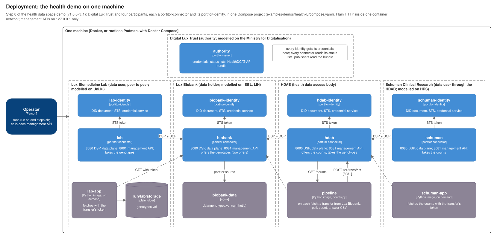
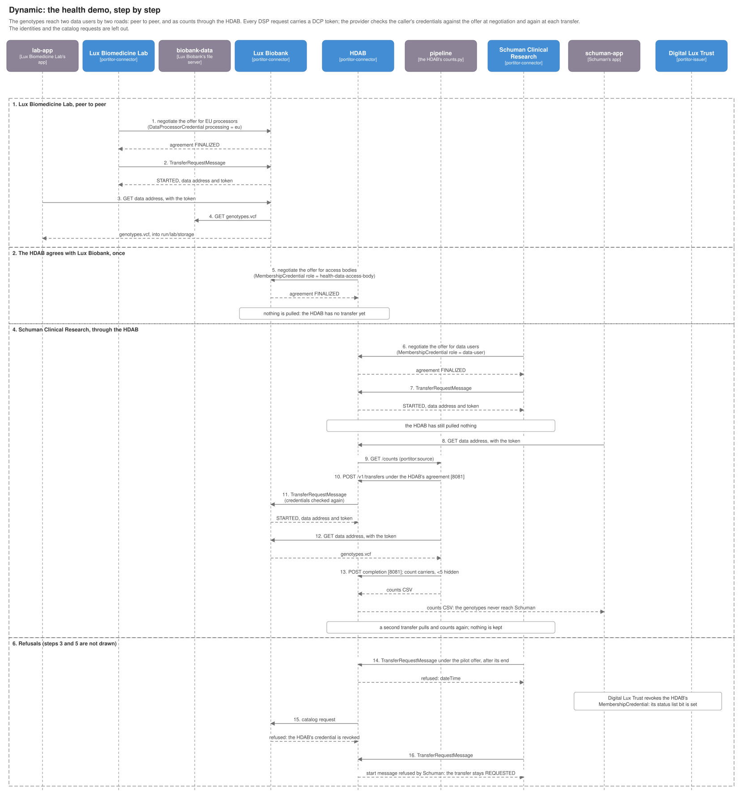

<!--
SPDX-FileCopyrightText: Portitor contributors

SPDX-License-Identifier: Apache-2.0
-->

# Health data demo: a Luxembourg-style health data space

Five parties share synthetic genotypes the way the European Health Data
Space (EHDS, [Regulation (EU) 2025/327](https://eur-lex.europa.eu/eli/reg/2025/327/oj))
plans it for secondary use. One data user agrees with the data holder
directly, peer to peer. Another gets only counts, made by a health data
access body (HDAB). This is step 0 of the health data space demo in the
[roadmap](../../../docs/ROADMAP.md#the-health-dataspace-demo). It uses
only what v1.0.0-rc.1 can do, and it grows as releases 1.1 to 1.3 land.



## The cast

The organisations are made up. Each one is modelled on a Luxembourg
institution that could play the role. None of those institutions takes
part in or endorses this demo. Luxembourg has not named its HDAB yet,
so the demo calls it just "HDAB".

| Party | Role in the data space | Modelled on |
| --- | --- | --- |
| Digital Lux Trust | The authority: issues the credentials and the HealthDCAT-AP bundle, and grants no data access | Ministry for Digitalisation |
| Lux Biobank | Health data holder: offers the genotypes | Integrated Biobank of Luxembourg (IBBL), part of LIH |
| Lux Biomedicine Lab | Data user, peer to peer: takes a copy of the genotypes | University of Luxembourg |
| HDAB | Health data access body: gets the genotypes, counts, offers only the counts | Luxembourg's future HDAB |
| Schuman Clinical Research | Data user through the HDAB: gets only the counts | Hôpitaux Robert Schuman |

Each participant runs a `portitor-connector` and a `portitor-identity`.
Digital Lux Trust runs `portitor-issuer`. All of it runs in one Compose
file on one machine ([compose.yaml](compose.yaml)), 11 containers in all.
Two more run only when needed: the two data users' apps, which fetch the
data of a started transfer.

The credentials are the ones Portitor already knows
([examples/issuer-credentials.json](../../issuer-credentials.json)):

| Participant | `MembershipCredential` `role` | `DataProcessorCredential` `processing` |
| --- | --- | --- |
| Lux Biobank | `data-holder` | none |
| Lux Biomedicine Lab | `data-user` | `eu` |
| HDAB | `health-data-access-body` | none |
| Schuman Clinical Research | `data-user` | none |

The `role` values are demo values. No specification defines them.

## The data

[data/genotypes.vcf](data/genotypes.vcf) holds synthetic genotypes:
410 variants on 100 kb of simulated human DNA, for 150 people, 50 in
each of three populations (YRI, CEU and CHB, the names of the
out-of-Africa model of [Gutenkunst et al., 2009](https://doi.org/10.1371/journal.pgen.1000695)).
Each person's population is in the VCF header (`##SAMPLE` lines, as the
VCF 4.3 specification shows them). No real person is in the file.

[data/generate.py](data/generate.py) makes it with
[msprime](https://tskit.dev/msprime/) 1.3.4 and
[stdpopsim](https://popsim-consortium.github.io/stdpopsim-docs/) 0.3.0,
with a fixed seed. Both are GPL-3.0. They run only to make the file and
are not shipped. The GNU GPL FAQ says a program's output is generally
not covered by the program's licence
([GPL FAQ](https://www.gnu.org/licenses/gpl-faq.html#WhatCaseIsOutputGPL)).
The file is licensed like the rest of the repository.

Why not real data? None of the public synthetic or open genomic datasets
we checked (the CINECA synthetic cohorts, HAPNEST, 1000 Genomes) states
a licence that lets us copy it into this repository.

## The datasets

Two datasets, by two publishers, both in HealthDCAT-AP and checked
against the data space's release 8 bundle when each connector starts:

- Lux Biobank's **genotypes** ([datasets/biobank.json](datasets/biobank.json)),
  health categories HGPD (human genetic data) and EINS (biobanks). Two
  offers: one for access bodies (`MembershipCredential.role` =
  `health-data-access-body`, until 2027-12-31), one for EU processors
  (`DataProcessorCredential.processing` = `eu`, until 2027-06-30).
- The HDAB's **carriers of each variant per population**
  ([datasets/hdab.json](datasets/hdab.json)), health category HGPD. One
  offer for data users (`MembershipCredential.role` = `data-user`, until
  2027-12-31). `run.sh` adds a pilot offer with the same terms that ends
  a few minutes after the start, to show an ended offer.

The health category labels come from the HealthDCAT-AP code list as
[metadata101/dcat-ap](https://github.com/metadata101/dcat-ap/blob/main/resources/thesauri/theme/health-healthcategory.rdf)
copies it. The official page could not be read from here.

The HDAB's source is its pipeline, [pipeline/counts.py](pipeline/counts.py)
(Python standard library only). It runs only when Schuman Clinical
Research's app fetches the data of a started transfer. Then it starts a
transfer from Lux Biobank under the HDAB's agreement, through the HDAB's
own management API. It pulls the genotypes, completes that transfer and
counts. For each variant it gives the people per population who carry
it. Counts from 1 to 4 show as `<5`, and a variant below 5 in every
population is left out. Nothing is kept. The pipeline stands in for a
secure processing environment (EHDS Art. 73), which this demo does not
build.

## Run it

```sh
examples/demos/health-lu/run.sh                    # the release images
CONTAINER_ENGINE=podman examples/demos/health-lu/run.sh
examples/demos/health-lu/run.sh <connector image> <identity image> <issuer image>
```

It needs Docker or Podman with Docker Compose, bash 4.4 or later, curl,
jq and openssl ([docs/TESTING.md, "Docker or Podman"](../../../docs/TESTING.md#docker-or-podman)).
It takes about two and a half minutes, most of it waiting for the pilot
offer to end. `PILOT_SECONDS=60` makes that shorter. `KEEP=1` leaves
everything running, with the keys in `run/`. The management APIs are then
on `127.0.0.1`: Digital Lux Trust 18071, Lux Biobank 18101, the lab
18111, the HDAB 18121, Schuman Clinical Research 18131. The key of each
is in `run/<participant>/management.key`.

The check of the pipeline's count runs without containers:

```sh
cd examples/demos/health-lu/pipeline && python3 -m unittest
```

## The scenario



[steps.sh](steps.sh) runs it. Every call goes through a participant's own
management API. Each step prints what it checks and stops at the first
failure.

1. **Lux Biomedicine Lab, peer to peer.** The lab reads Lux Biobank's
   catalog and takes the offer for EU processors. Lux Biobank checks its
   `DataProcessorCredential`. The lab's app pulls the genotypes into the
   lab's plain folder (`run/lab/storage`) and the file is checked
   against the original. The offer for access bodies is refused to the
   lab, because its role is `data-user`.
2. **The HDAB.** The HDAB takes Lux Biobank's offer for access bodies,
   once. Nothing is pulled yet: the HDAB has no transfer.
3. **Schuman Clinical Research and Lux Biobank.** Both of Lux Biobank's
   offers are refused to Schuman Clinical Research. It is not an access
   body and holds no `DataProcessorCredential`.
4. **Schuman Clinical Research, through the HDAB.** Schuman takes the
   HDAB's offer for data users. After the agreement, and again after its
   transfer has started, the HDAB still has pulled nothing. Only when
   Schuman's app fetches the data does the pipeline pull from Lux Biobank
   and count. The counts are checked against `counts.py` run on the
   file. A second transfer pulls again. Schuman also takes the pilot
   offer and transfers once.
5. **A known gap.** The lab is a data user too, so the HDAB agrees with
   it as well. There is no data permit to require until 1.2.
6. **Refusals.** Once the pilot offer has ended, a new transfer under it
   is refused. Then Digital Lux Trust revokes the HDAB's
   `MembershipCredential`, and the HDAB is out of the data space. Lux
   Biobank refuses to show it its catalog. Schuman's connector refuses
   the HDAB's messages, so a new transfer never starts, and Schuman ends
   it itself.

## What it answers

The [roadmap](../../../docs/ROADMAP.md#the-health-dataspace-demo) asks four
questions. Here is what rc.1 shows.

| Question | What the run shows |
| --- | --- |
| Can the same data be reached through several channels? | Yes. One dataset at Lux Biobank with two offers gives two agreements: the lab's (step 1) and the HDAB's (step 2). Schuman reaches the same data only as counts, through the HDAB (step 4). |
| Does the HDAB negotiate with Lux Biobank for every new query? | No. One agreement covers every pull. Each pull is a new transfer, and Lux Biobank checks the HDAB's credentials again at each one (steps 4 and 6). rc.1 sends no parameters with a fetch, so a different query needs its own dataset and offer at the HDAB. |
| Does the HDAB negotiate with Lux Biobank for every new data user? | No. Each data user agrees with the HDAB only (steps 4 and 5). Nothing ties those agreements to the HDAB's agreement with Lux Biobank ([R-39](../../../docs/RISKS_AND_TECHNICAL_DEBTS.md#r-39)). |
| Can the HDAB's policy be less strict, and what can never be wider? | The policies differ: Lux Biobank asks for an access body, the HDAB for any data user. The HDAB's end date (2027-12-31) is no later than its own agreement's, but only because it was written so by hand. Nothing checks it. Purpose cannot be stated until 1.2. Which users may take the counts cannot be limited either (step 5). |

## Gaps and findings

- **No data permit** (1.2): any member with `role` = `data-user` can take
  the HDAB's offer, the lab too (step 5).
- **No link between agreements** (1.3,
  [R-39](../../../docs/RISKS_AND_TECHNICAL_DEBTS.md#r-39)): the HDAB's
  offer is kept inside its own agreement by hand.
- **Pull only** (1.1, [TD-10](../../../docs/RISKS_AND_TECHNICAL_DEBTS.md#td-10)):
  the lab's app fetches into a plain folder instead of object storage.
- **No secure processing environment**: a fixed pipeline stands in.
- **The chained fetch has 30 seconds.** The HDAB's data plane waits at
  most 30 seconds for its source (`UPSTREAM_TIMEOUT`, fixed in code). The
  pipeline's whole pull and count must fit. `steps.sh` prints how long
  the fetch took (with bash 5): 0.9 seconds on 2026-11-23, with
  locally built images on a cloud Linux machine, so far from the limit
  with this small file.
- **A revoked party leaves its counter-parties waiting.** After the
  revocation, Schuman's connector refuses the HDAB's messages, which is
  right. But that includes the HDAB's termination, so Schuman's transfer
  stays `REQUESTED` until Schuman ends it itself (step 6).
- **The catalog shows every offer to every member**
  ([TD-13](../../../docs/RISKS_AND_TECHNICAL_DEBTS.md#td-13)): Schuman
  sees offers it cannot meet.

Findings from running it go into issues. A finding that needs an API or
configuration change blocks 1.0.0.
