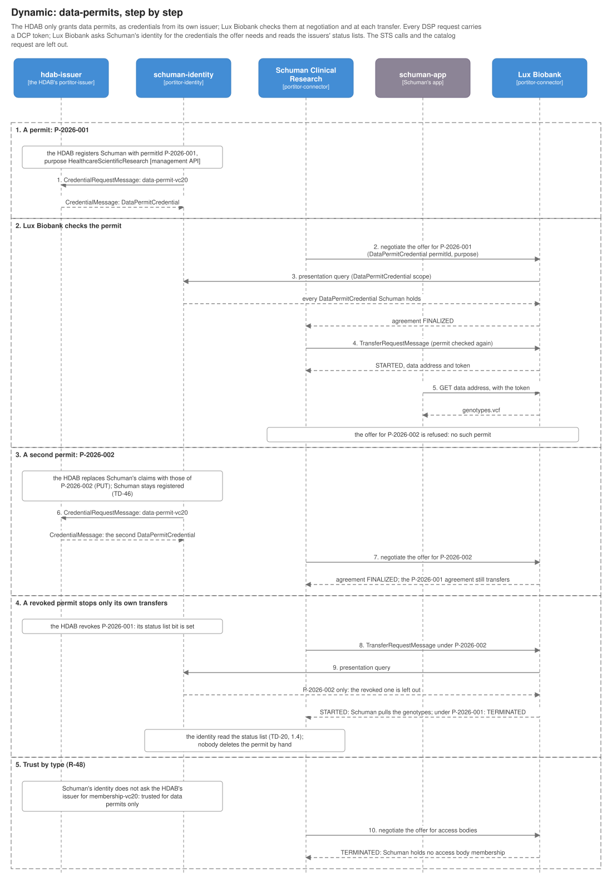

<!--
SPDX-FileCopyrightText: Portitor contributors

SPDX-License-Identifier: Apache-2.0
-->

# data-permits: the HDAB grants data permits, the holder checks them

A health data space for secondary use, the way the European Health Data
Space (EHDS, [Regulation (EU) 2025/327](https://eur-lex.europa.eu/eli/reg/2025/327/oj))
plans it, on one machine. Changes are in its [changelog](CHANGELOG.md).

## What it is about

Here the health data access body (HDAB) does not fetch or count
anything. It only grants data permits, as verifiable credentials from
its own issuer. Schuman Clinical Research holds them, and Lux Biobank
checks them itself: one offer per permit, checked when Schuman
negotiates and again at each transfer. This is way F of the
[roadmap](../../docs/ROADMAP.md#ways-to-link-data-user-hdab-and-holder-maintainer-2026-11-23),
permit-gated peer to peer.

It asks: can v1.0.0-rc.1 carry a data permit with configuration alone,
and what breaks when a data user holds several permits and one is
revoked?

### Who takes part

The organisations are made up. Each one is modelled on a Luxembourg
institution that could play the role. None of those institutions takes
part in or endorses this scenario. Luxembourg has not named its HDAB
yet, so the scenario calls it just "HDAB".

| Party | Role | Modelled on | Runs |
| --- | --- | --- | --- |
| Digital Lux Trust | The authority: issues the memberships and the HealthDCAT-AP bundle | Ministry for Digitalisation | `portitor-issuer` |
| HDAB | Health data access body: grants data permits. It needs no connector here | Luxembourg's future HDAB | `portitor-issuer` |
| Lux Biobank | Health data holder: offers the genotypes, one offer per permit | Integrated Biobank of Luxembourg (IBBL), part of LIH | `portitor-connector`, `portitor-identity` |
| Schuman Clinical Research | Data user: holds the permits and gets the genotypes | Hôpitaux Robert Schuman | `portitor-connector`, `portitor-identity` |

Digital Lux Trust gives Lux Biobank a `MembershipCredential` with the
`role` `data-holder`, and Schuman one with `data-user`. The HDAB's
issuer has its own credential definitions,
[hdab-issuer-credentials.json](hdab-issuer-credentials.json): a
`DataPermitCredential` (claims `permitId` and `purpose`) and, on
purpose, a `MembershipCredential` (step 5).


### The data and the dataset

Lux Biobank's data are the [synthetic genotypes](../../examples/genotypes/)
in `examples/genotypes/`: no real person is in them. Its dataset
([datasets/biobank.json](datasets/biobank.json)) is in HealthDCAT-AP,
checked against the data space's release 8 bundle at start, with three
offers: one per permit (`DataPermitCredential.permitId` = `P-2026-001`,
or `P-2026-002`, and `DataPermitCredential.purpose` =
`scientific-research`, until 2027-12-31), and one for access bodies
(`MembershipCredential.role` = `health-data-access-body`).

## Scope

In:

- A data permit as a credential type defined only in the HDAB issuer's
  configuration ([hdab-issuer-credentials.json](hdab-issuer-credentials.json)),
  with no code.
- Two permits held at once by one data user (maintainer, 2026-11-24),
  each with its own offer and agreement.
- Revoking a permit, and what it does to the other.
- A second trusted issuer next to the authority, and what it may issue.

Out, on purpose:

- A real permit format. The claims `permitId` and `purpose` are
  placeholders: EHDS Art. 68(10) lists what a permit states, and the
  template of Art. 70 is still to come. The permit's end is the
  credential's own `validUntil`.
- A secure processing environment. Schuman pulls the genotypes itself.
  The EHDS would not allow that for these data (Art. 73), so this shows
  the checks only.
- Sending the data where the permit says: that needs push transfers and
  a destination check (1.1, 1.4).
- An ODRL `purpose` constraint (1.4): the purpose is checked as a claim
  of the permit.

## Components tested, and why

| Component or interface | Why it is in the story |
| --- | --- |
| `portitor-issuer` (the HDAB's) | Issues the permits from configuration alone; one registration per participant, so a second permit means registering again; revokes a permit. |
| `portitor-issuer` (Digital Lux Trust) | Issues the memberships and serves the HealthDCAT-AP bundle. |
| `portitor-identity` (Schuman) | Trusts both issuers, stores both permits, presents every credential of the type asked for, and deletes the revoked permit. |
| `portitor-connector` as provider (Lux Biobank) | Trusts both issuers (`PORTITOR_TRUSTED_ISSUERS`), reads `DataPermitCredential` claims in its offers (`PORTITOR_POLICY_CREDENTIALS`), checks them at negotiation and at each transfer, refuses a presentation with a revoked credential. |
| `portitor-connector` as consumer (Schuman) | Asks for the `DataPermitCredential` scope the offer needs, negotiates and transfers. |
| The built-in data plane (HTTP pull) | Schuman's app fetches the genotypes, checked against the original. |
| Status lists | Lux Biobank reads the HDAB issuer's list and sees the revoked permit. |

## Run it

```sh
scenarios/data-permits/run.sh
```

It needs Docker or Podman with Docker Compose, bash 4.4 or later, curl,
jq and openssl ([docs/TESTING.md, "Docker or Podman"](../../docs/TESTING.md#docker-or-podman)).
The images can be given as arguments, and `CONTAINER_ENGINE=podman`
picks Podman, as in [hdab-intermediary](../hdab-intermediary/README.md#run-it).
[run.sh](run.sh) writes the keys into `run/`, starts the 8 containers of
[compose.yaml](compose.yaml), has Digital Lux Trust register the two
participants and issue their memberships, then runs
[steps.sh](steps.sh), the steps below. It takes about a minute.

`KEEP=1` leaves everything running, with the keys in `run/`. The
management APIs are then on `127.0.0.1`: Digital Lux Trust 18071, the
HDAB's issuer 18125, Lux Biobank 18101, Schuman Clinical Research 18131.
The key of each is in `run/<party>/management.key`. The host ports are
those of hdab-intermediary, so run one at a time.

## The steps



1. **A permit.** The HDAB's issuer registers Schuman with the claims of
   permit P-2026-001, and Schuman's identity asks for the
   `DataPermitCredential`.
2. **The holder checks it.** Schuman takes Lux Biobank's offer for
   P-2026-001 and pulls the genotypes, checked against the original. The
   offer for P-2026-002 is refused: Schuman has no such permit.
3. **A second permit.** A data user may hold several permits at once.
   The issuer keeps one set of claims per participant, so the HDAB
   deletes Schuman's registration and makes it again with P-2026-002.
   Schuman holds both, takes the second offer, and the first agreement
   still works.
4. **A revoked permit.** The HDAB revokes P-2026-001, and a transfer
   under it is refused. A transfer under P-2026-002 is refused too:
   Schuman shows every permit it holds, and Lux Biobank refuses a
   presentation that holds a revoked credential. Schuman's record gives
   no reason; the script checks that Lux Biobank's log does. Once
   Schuman deletes the revoked permit from its identity, P-2026-002
   works again.
5. **Trust covers every type.** The HDAB's issuer gives Schuman a
   `MembershipCredential` with the role `health-data-access-body`, and
   Lux Biobank's offer for access bodies accepts it. The HDAB issuer's
   configuration holds a `MembershipCredential` on purpose, to show
   this.

## Findings

- **An issuer trusted for permits can issue memberships too**
  ([R-48](../../docs/RISKS_AND_TECHNICAL_DEBTS.md#r-48), fix planned
  for 1.4): trusted issuers are one list for every credential type
  (step 5). The list is configuration, so an issuer also stays trusted
  when its owner leaves the data space.
- **One revoked permit blocks all the others**
  ([TD-20](../../docs/RISKS_AND_TECHNICAL_DEBTS.md#td-20), fix planned
  for 1.4) until the data user deletes it, and the data user is told no reason (step 4).
- **One set of claims per participant at the issuer**
  ([TD-46](../../docs/RISKS_AND_TECHNICAL_DEBTS.md#td-46), fix planned
  for 1.4): a second
  permit needs the registration made again (step 3).
- **One offer per permit.** Lux Biobank must add an offer, by editing
  its datasets file, for each permit the HDAB grants; here both are
  written in advance.
- **The catalog shows every offer to every member**
  ([TD-13](../../docs/RISKS_AND_TECHNICAL_DEBTS.md#td-13)): every member
  sees the offers for every permit.
