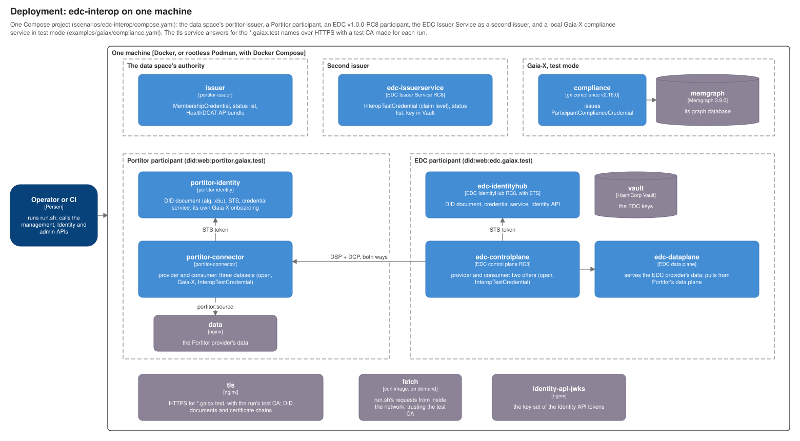
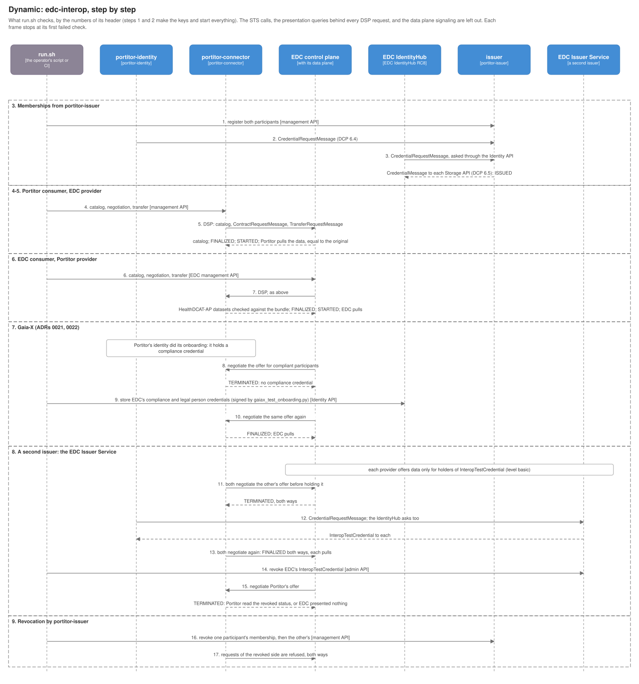

<!--
SPDX-FileCopyrightText: Portitor contributors

SPDX-License-Identifier: Apache-2.0
-->

# edc-interop: Portitor and Eclipse EDC in one data space

A Portitor participant and an Eclipse Dataspace Components (EDC)
participant, members of the same data space, each provider and consumer
of the other. Changes are in its [changelog](CHANGELOG.md).
[docs/TESTING.md, "EDC interop test"](../../docs/TESTING.md#edc-interop-test)
keeps the detail: the expected result of each step, what is pinned, the
last run that passed, and what EDC needs.

## What it is about

Portitor must work with EDC, the most used connector (ADR 0011). Here a
Portitor participant and an EDC v1.0.0-RC8 participant get their
memberships from Portitor's issuer, read each other's catalogs, agree
contracts and pull data, both ways, and EDC asks Portitor to push data
to it. Then each needs a credential of a
second issuer, the EDC Issuer Service, and Portitor asks EDC for a Gaia-X
compliance credential.

It asks: do DSP 2025-1 and DCP v1.0.1, as Portitor and EDC each read
them, work together, for credentials from either side's issuer?



## Scope

In:

- Credentials issued by `portitor-issuer` to both identities (DCP 6.4,
  6.5), and by the EDC Issuer Service to both.
- Catalog, negotiation and HTTP pull transfer, Portitor to EDC and EDC to
  Portitor.
- HTTP push transfer (`HttpData-PUSH`, ADR 0027 section 1) with EDC as
  consumer and Portitor as provider: Portitor sends the data to the
  endpoint EDC names.
- The HealthDCAT-AP bundle: EDC reads a Portitor catalog checked against
  it.
- Gaia-X: an EDC participant holds and presents a Gaia-X compliance
  credential, and a Portitor provider requires it (ADRs 0021, 0022).
- Revocation both ways, by each issuer.

Out, on purpose:

- EDC as the provider asking for Gaia-X compliance: EDC refuses a
  credential whose subject is not the presenter
  ([TESTING, "Gaia-X with EDC"](../../docs/TESTING.md#gaia-x-with-edc-what-the-test-shows-and-what-it-does-not)).
- A real Gaia-X trust anchor: the compliance service runs in test mode,
  with a test CA and a test notary
  ([R-12](../../docs/RISKS_AND_TECHNICAL_DEBTS.md#r-12)).
- Push with Portitor as consumer and EDC as provider: EDC v1.0.0-RC8
  ships no data plane, and the test one in `runtimes/dataplane` does not
  send data. Push into object storage (ADR 0027, sections 2 to 4) is in
  the two-party scenario.
- The EDC Management API v4 beyond what the steps call.

## Components tested, and why

| Component or interface | Why it is in the story |
| --- | --- |
| `portitor-issuer` | The data space's authority: registers both participants, issues their `MembershipCredential`s, serves the HealthDCAT-AP bundle and its status list; revokes in step 9. |
| `portitor-identity` | Asks both issuers for credentials, stores them, answers EDC's presentation queries; does its own Gaia-X onboarding. |
| `portitor-connector` as consumer | Reads EDC's catalog, negotiates, pulls from the EDC data plane, through its management API. |
| `portitor-connector` as provider | Serves a catalog EDC reads, checks EDC's credentials (membership, Gaia-X compliance, the EDC Issuer Service's test credential) and their status lists; pushes a dataset to the endpoint EDC names. |
| EDC control plane, data plane, IdentityHub, Issuer Service (v1.0.0-RC8) | The other side: built from `runtimes/` with pinned versions, as EDC publishes no images. The test data plane (`runtimes/dataplane`) also receives the push and keeps what arrived. |
| Gaia-X compliance service (gx-compliance v2.16.0, test mode) | Issues the compliance credentials ([examples/gaiax/compliance.yaml](../../examples/gaiax/compliance.yaml)). |
| PostgreSQL (`postgres` 19) | One database and role per Portitor component, over TLS ([ADR 0029](../../docs/adr/0029-several-replicas.md)): the documented default from 1.3. A store bug that only PostgreSQL shows would show here. |

## Run it

```sh
scenarios/edc-interop/run.sh               # the images of the commit, built first
scenarios/edc-interop/run.sh --no-build    # reuse the EDC images already built
```

Build the Portitor images first
([TESTING, "Building the images locally"](../../docs/TESTING.md#building-the-images-locally)),
or name them with `PORTITOR_IMAGE`, `PORTITOR_IDENTITY_IMAGE` and
`PORTITOR_ISSUER_IMAGE`. It needs Docker or Podman with Docker Compose,
bash 4.4 or later, curl, jq, openssl, python3 with `cryptography`, and
Internet access: Maven Central for the EDC build, and the Gaia-X
Registry, `w3id.org` and `www.w3.org` for the compliance service.
`KEEP=1` leaves it running, `LOGS=FILE` writes every container's log on
a failure, `CONTAINER_ENGINE=podman` picks Podman. The CI job, build
included, took five minutes on 2026-11-24. CI runs it on pull requests that
touch what it reads, and nightly (`EDC interop`).

## The steps



[run.sh](run.sh) holds the steps and their checks; the numbers are those
of its header comment. Steps 1 and 2 make the keys and start everything.

3. **Memberships.** Each identity asks `portitor-issuer` for its
   `MembershipCredential` through its own API, and the issuer delivers
   it.
4. **EDC accepts Portitor.** The EDC provider's catalog, read through
   Portitor's management API: EDC checks Portitor's token and credential.
5. **Portitor consumer, EDC provider.** Negotiation `FINALIZED`, pull
   transfer, the bytes equal the original.
6. **EDC consumer, Portitor provider.** EDC reads the HealthDCAT-AP
   datasets, checked against the bundle; negotiation, pull transfer.
   Then, under the same agreement, EDC asks for `HttpData-PUSH`: its
   data plane names the endpoint (`endpointType`
   `https://w3id.org/dspace-sig/profile/http-push`, a bearer token),
   Portitor `POST`s the dataset there and completes the transfer.
   `COMPLETED` on both sides, and the bytes the EDC data plane received
   equal the file.
7. **Gaia-X.** Portitor's identity holds a compliance credential. The
   Portitor provider's offer for compliant participants refuses EDC,
   then admits it once EDC holds its own compliance credential.
8. **A second issuer, the EDC Issuer Service.** Each provider offers data
   only for holders of its `InteropTestCredential`: refused both ways
   before, agreed both ways after each identity got it. Once the EDC
   Issuer Service revokes EDC's credential, Portitor refuses EDC.
9. **Revocation by `portitor-issuer`.** Once it revokes a participant's
   membership, the other refuses it, both ways.

## Findings

- **EDC v1.0.0-RC8 asks for a push through its data plane.** Its
  management API's `TransferRequest` has no data destination: as
  consumer, the control plane asks a data plane registered for the
  transfer type to prepare the flow, and sends the data address the data
  plane returns, as it is, in the `TransferRequestMessage`. So the
  `endpointType` and the token are the data plane's choice; the test data
  plane uses the Data Plane Signaling HTTP profile's push type, which
  Portitor requires.
- **EDC acknowledges the start of a push before it is ready for the
  end.** On the provider's `TransferStartMessage` EDC answers 200 but
  stays in `STARTUP_REQUESTED`, shown as `REQUESTED` over DSP, until its
  state machine (one pass a second by default) tells its data plane; a
  `TransferCompletionMessage` before that gets 400. A small dataset is
  pushed within that second, so a provider that completes right after
  the push loses the race and the transfer ends terminated. Portitor
  therefore pushes only once EDC reports the transfer is no longer
  `REQUESTED` (it asks for the state, for at most 30 seconds; ADR 0027).
  The test data plane takes the push at once, so this step checks that
  wait.

- **EDC as provider cannot ask for Gaia-X compliance** (out of scope
  above): EDC refuses a credential whose subject is not the presenter,
  and the subject of a compliance credential is `<credential id>#cs`
  (ADR 0022).
- **Step 8g can pass for one of two reasons.** Either Portitor read the
  revoked status itself, or the IdentityHub saw the revocation first
  and no longer presented the credential. The run says which, with a
  CI warning in the second case.
- **The trusted issuers are one list for every credential type**
  ([R-48](../../docs/RISKS_AND_TECHNICAL_DEBTS.md#r-48)): the Portitor
  components trust the EDC Issuer Service, so they would take a
  membership from it too. The run does not try it.
