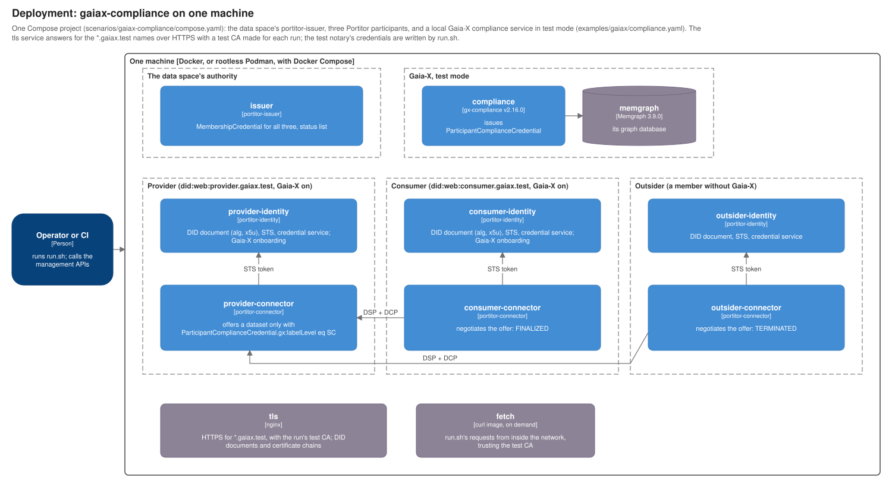
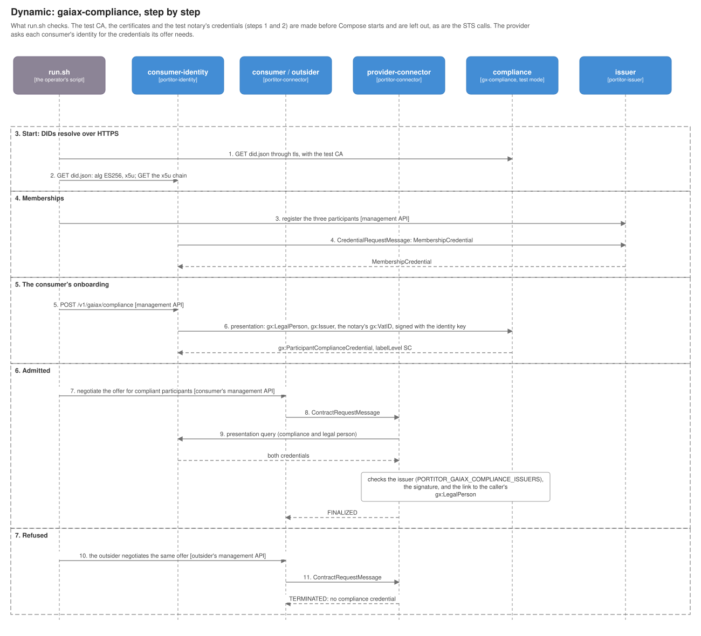

<!--
SPDX-FileCopyrightText: Portitor contributors

SPDX-License-Identifier: Apache-2.0
-->

# gaiax-compliance: a provider that admits only Gaia-X compliant participants

Portitor participants get a Gaia-X compliance credential from a local
Gaia-X compliance service, and a provider offers a dataset only to
holders of one. Changes are in its [changelog](CHANGELOG.md).
[docs/TESTING.md, "Gaia-X end-to-end test"](../../docs/TESTING.md#gaia-x-end-to-end-test)
keeps the detail, and how to look around a kept run.

## What it is about

A Gaia-X participant proves its compliance with a credential from a
Gaia-X compliance service. Portitor's identity does the onboarding
itself (ADR 0021), and a Portitor provider can require the credential
in an offer (ADR 0022). Three members take part: a provider and a
consumer with Gaia-X on, and an outsider, a member without it.

It asks: can a Portitor identity build what a Gaia-X compliance service
accepts, and does a Portitor provider check the answer before it agrees?



## Scope

In:

- A test CA, the certificates of the identity keys, and DID documents
  with `alg` `ES256` and `x5u`, resolved over HTTPS.
- The onboarding (`POST /v1/gaiax/compliance`) and the
  `gx:ParticipantComplianceCredential` it gives.
- An offer with `ParticipantComplianceCredential.gx:labelLevel` `eq`
  `SC`: agreed with the compliant consumer, refused to the outsider.

Out, on purpose:

- A real Gaia-X trust anchor: the compliance service runs in test mode
  (`DISABLE_SIGNATURE_CHECK=true`, `production=false`), and the notary
  and the CA are made for the run.
- The Gaia-X Lab and a GXDCH notary
  ([spike 0.8](../../docs/spikes/0.8-gaia-x-compliance.md)).
- EDC: [edc-interop](../edc-interop/) has the Gaia-X steps with EDC.
- A transfer: the agreement is what is checked.

## Components tested, and why

| Component or interface | Why it is in the story |
| --- | --- |
| `portitor-issuer` | The data space's authority: issues the three `MembershipCredential`s. |
| `portitor-identity` with Gaia-X on (provider, consumer) | Publishes `alg` and `x5u` in its DID document, signs the Gaia-X credentials and the presentation, runs the onboarding, stores and presents the compliance credential. |
| `portitor-identity` without Gaia-X (outsider) | A member that holds no compliance credential. |
| `portitor-connector` as provider | Trusts the compliance service (`PORTITOR_GAIAX_COMPLIANCE_ISSUERS`) and checks the credential, its issuer and its link to the caller's `gx:LegalPerson` before it agrees. |
| `portitor-connector` as consumer | Reads the catalog and negotiates through its management API. |
| Gaia-X compliance service (gx-compliance v2.16.0, test mode, Memgraph 3.9.0) | Issues the compliance credentials ([examples/gaiax/compliance.yaml](../../examples/gaiax/compliance.yaml)). |
| Test notary ([scripts/gaiax_test_notary.py](../../scripts/gaiax_test_notary.py)) | Signs each Gaia-X participant's registration number credential (`gx:VatID`). |

## Run it

```sh
scenarios/gaiax-compliance/run.sh
```

Build the Portitor images first
([TESTING, "Building the images locally"](../../docs/TESTING.md#building-the-images-locally)),
or name them with `PORTITOR_IMAGE`, `PORTITOR_IDENTITY_IMAGE` and
`PORTITOR_ISSUER_IMAGE`. It needs Docker or Podman with Docker Compose,
bash 4.4 or later, curl, jq, openssl, python3 with `cryptography`, and
Internet access: the compliance service loads its shapes and contexts
from the Gaia-X Registry, `w3id.org` and `www.w3.org`. `KEEP=1` leaves
it running, `LOGS=FILE` writes every container's log on a failure,
`CONTAINER_ENGINE=podman` picks Podman. The CI job took three minutes on
2026-11-24. CI runs it on pull requests that touch what it reads, and
nightly (`Gaia-X`).

## The steps



[run.sh](run.sh) holds the steps and their checks; the numbers are those
of its header comment.

1. **A test CA** and from it the certificates: the public names
   (`*.gaiax.test`), the compliance service (RSA, PS256), the test
   notary, and each Gaia-X identity's key.
2. **Registration numbers.** The test notary signs each Gaia-X
   participant's `gx:VatID`; each gets a participant file.
3. **Start.** The compliance service's DID and the participants' DIDs
   resolve over HTTPS with the test CA; each Gaia-X identity's DID
   document has `alg` `ES256` and an `x5u` that serves its chain.
4. **Memberships.** The issuer registers the three participants; each
   identity asks for its `MembershipCredential`.
5. **Onboarding.** The consumer's identity runs it and then holds a
   `gx:ParticipantComplianceCredential` from
   `did:web:compliance.gaiax.test`.
6. **Admitted.** The consumer negotiates the provider's offer:
   `FINALIZED`.
7. **Refused.** The outsider negotiates the same offer: `TERMINATED`.

## Findings

- **No real trust anchor yet**
  ([R-12](../../docs/RISKS_AND_TECHNICAL_DEBTS.md#r-12)). The run proves
  the exchange, not the trust: any certificate from the test CA and any
  notary is accepted. A run against the Gaia-X Lab needs a public
  `did:web`.
- **It depends on the Gaia-X Registry at run time.** A change there can
  break the run without a change in Portitor, hence the nightly run.
