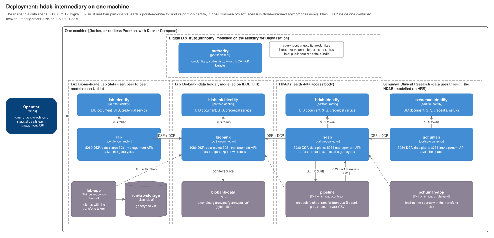
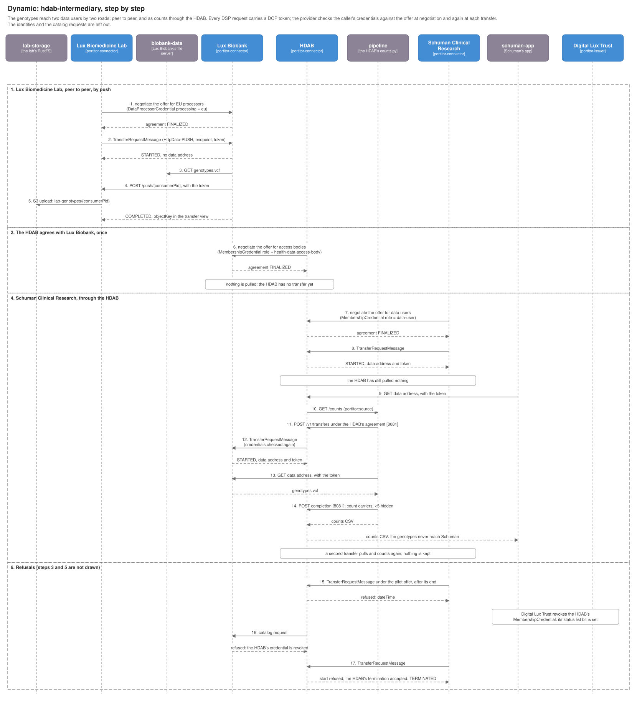

<!--
SPDX-FileCopyrightText: Portitor contributors

SPDX-License-Identifier: Apache-2.0
-->

# hdab-intermediary: the HDAB pulls, counts and passes on only the counts

A health data space for secondary use, the way the European Health Data
Space (EHDS, [Regulation (EU) 2025/327](https://eur-lex.europa.eu/eli/reg/2025/327/oj))
plans it, on one machine. Changes are in its [changelog](CHANGELOG.md).

## What it is about

Lux Biobank holds synthetic genotypes. Two data users reach them by two
roads. Lux Biomedicine Lab, an EU data processor, agrees with Lux
Biobank directly and takes a copy, peer to peer: Lux Biobank pushes it
into the lab's own object storage (1.1). Schuman Clinical
Research may not see the genotypes: it agrees with the health data
access body (HDAB), which pulls the genotypes from Lux Biobank only when
Schuman fetches, counts the carriers of each variant per population, and
passes on only the counts. This is way A of the
[roadmap](../../docs/ROADMAP.md#ways-to-link-data-user-hdab-and-holder-maintainer-2026-11-23),
the HDAB as intermediary.

It answers the roadmap's four questions for the health data space demo
([What it answers](#what-it-answers)).

### Who takes part

The organisations are made up. Each one is modelled on a Luxembourg
institution that could play the role. None of those institutions takes
part in or endorses this scenario. Luxembourg has not named its HDAB
yet, so the scenario calls it just "HDAB".

| Party | Role | Modelled on | `MembershipCredential` `role` | `DataProcessorCredential` `processing` |
| --- | --- | --- | --- | --- |
| Digital Lux Trust | The authority: issues the credentials and the HealthDCAT-AP bundle | Ministry for Digitalisation | | |
| Lux Biobank | Health data holder: offers the genotypes | Integrated Biobank of Luxembourg (IBBL), part of LIH | `data-holder` | none |
| Lux Biomedicine Lab | Data user, peer to peer: takes a copy of the genotypes | University of Luxembourg | `data-user` | `eu` |
| HDAB | Health data access body: gets the genotypes and offers only counts | Luxembourg's future HDAB | `health-data-access-body` | none |
| Schuman Clinical Research | Data user: gets the counts through the HDAB | Hôpitaux Robert Schuman | `data-user` | none |

Each participant runs a `portitor-connector` and a `portitor-identity`;
Digital Lux Trust runs `portitor-issuer`. Lux Biomedicine Lab also runs
its object storage, a RustFS server (`lab-storage`). The credentials are the ones
Portitor already knows
([examples/issuer-credentials.json](../../examples/issuer-credentials.json)).
The `role` values are scenario values: no specification defines them.



### The data and the datasets

Lux Biobank's data are the [synthetic genotypes](../../examples/genotypes/)
in `examples/genotypes/`: no real person is in them. Two datasets, by two
publishers, both in HealthDCAT-AP and checked against the data space's
release 8 bundle when each connector starts:

- Lux Biobank's **genotypes** ([datasets/biobank.json](datasets/biobank.json)),
  health categories HGPD (human genetic data) and EINS (biobanks). Two
  offers: one for access bodies (`MembershipCredential.role` =
  `health-data-access-body`, until 2027-12-31), one for EU processors
  (`DataProcessorCredential.processing` = `eu`, until 2027-06-30). Two
  distributions: `HttpData-PULL`, which the HDAB uses, and
  `HttpData-PUSH`, which the lab uses.
- The HDAB's **carriers of each variant per population**
  ([datasets/hdab.json](datasets/hdab.json)), health category HGPD. One
  offer for data users (`MembershipCredential.role` = `data-user`, until
  2027-12-31). `run.sh` adds a pilot offer with the same terms that ends
  a few minutes after the start, to show an ended offer.

The health category labels come from the HealthDCAT-AP code list as
[metadata101/dcat-ap](https://github.com/metadata101/dcat-ap/blob/main/resources/thesauri/theme/health-healthcategory.rdf)
copies it. The official page could not be read from here.

The HDAB's source is its pipeline, [pipeline/counts.py](pipeline/counts.py)
(Python standard library only). It runs only when Schuman Clinical
Research's app fetches the data of a started transfer. Then it starts a
transfer from Lux Biobank under the HDAB's agreement, through the HDAB's
own management API. It pulls the genotypes, completes that transfer and
counts. For each variant it gives the people per population who carry
it. Counts from 1 to 4 show as `<5`, and a variant below 5 in every
population is left out. Nothing is kept. The pipeline stands in for a
secure processing environment (EHDS Art. 73), which this scenario does
not build.

## Scope

In:

- Two offers of one dataset, each checking another credential, and two
  agreements on it: the lab's and the HDAB's.
- A push transfer (1.1, [ADR 0027](../../docs/adr/0027-push-transfers-and-object-storage.md)):
  Lux Biobank sends the genotypes to the lab connector's receiving
  route, which stores them in the lab's own RustFS bucket. The storage
  keys stay with the lab.
- A chained transfer: the HDAB's data source is a pipeline that pulls
  from Lux Biobank under the HDAB's own agreement, during Schuman's
  fetch, and keeps nothing.
- Refusals: the wrong role, a missing credential, an offer whose end has
  passed, a revoked member.

Out, on purpose:

- A data permit: none exists before 1.4, so any data user may take the
  HDAB's offer (step 5).
- A secure processing environment (EHDS Art. 73): a fixed pipeline
  stands in.
- Object storage at Lux Biobank (`s3://` sources, 1.1): its file stays
  on a plain web server. The two-party scenario shows an `s3://`
  source.
- Push for the HDAB: its pipeline pulls, because it keeps nothing.
- A link between the HDAB's agreement with Lux Biobank and its
  agreements with data users (1.5, R-39).

## Components tested, and why

| Component or interface | Why it is in the story |
| --- | --- |
| `portitor-issuer` (Digital Lux Trust) | Registers the participants and issues their `MembershipCredential` and `DataProcessorCredential`; revokes the HDAB's membership in step 6. Serves the HealthDCAT-AP bundle. |
| `portitor-identity`, one per participant | Holds the credentials, signs the presentations, and is the STS every DSP request needs (DCP). |
| `portitor-connector` as provider (Lux Biobank, the HDAB) | Harvests its datasets, checks them against the bundle (SHACL), serves its catalog, checks each offer's credential constraints at negotiation and again at each transfer. |
| `portitor-connector` as consumer (the lab, the HDAB, Schuman) | Reads catalogs, negotiates, requests transfers, through its management API. The HDAB is both provider and consumer. |
| The built-in data plane (HTTP pull) | Proxies the data with a token. In the chain, the HDAB's data plane waits up to 30 s for its pipeline. |
| The built-in data plane (HTTP push, 1.1) | Lux Biobank's data plane sends the genotypes to the lab's receiving route, `POST /push/{consumerPid}`, with the token the lab gave in its transfer request, then completes the transfer. |
| The consumer's receiving route (1.1) | The lab's connector checks the token and streams the body into its bucket (`PORTITOR_PUSH_BUCKET`) as object `{consumerPid}`; the transfer view shows `objectKey`. Without the token: 401. |
| RustFS (`rustfs/rustfs:1.0.6`), the lab's object storage | Bucket `lab-genotypes`. The lab's connector reaches it with the standard `AWS_ENDPOINT_URL_S3`, `AWS_ACCESS_KEY_ID` and `AWS_SECRET_ACCESS_KEY` settings. |
| Status lists | Lux Biobank and Schuman refuse the HDAB once its membership is revoked. |
| PostgreSQL (`postgres` 19) | One database and role per Portitor component, over TLS ([ADR 0029](../../docs/adr/0029-several-replicas.md)): the documented default from 1.3. A store bug that only PostgreSQL shows would show here. |

## Run it

**It needs 1.1 images.** Step 1 is a push transfer, and step 6 needs
the TD-47 fix; both are new in 1.1. `compose.yaml` names the 1.2.0
release images by default, and `run.sh` stops at once with a 1.0
connector image. To try images built from source ([docs/TESTING.md, "Building the images locally"](../../docs/TESTING.md#building-the-images-locally);
with Podman, `podman build --format docker`):

```sh
scenarios/hdab-intermediary/run.sh portitor-connector:ci portitor-identity:ci portitor-issuer:ci
CONTAINER_ENGINE=podman scenarios/hdab-intermediary/run.sh portitor-connector:ci portitor-identity:ci portitor-issuer:ci
```

It needs Docker or Podman with Docker Compose, bash 4.4 or later, curl
7.75 or later (it signs the requests to the lab's bucket with
`--aws-sigv4`), jq and openssl ([docs/TESTING.md, "Docker or Podman"](../../docs/TESTING.md#docker-or-podman)).
[run.sh](run.sh) writes the keys into `run/`, makes the keys of the
lab's object storage for this run, starts the 13 containers of
[compose.yaml](compose.yaml), has Digital Lux Trust register the four
participants and issue their credentials, then runs
[steps.sh](steps.sh), the steps below. Schuman's app runs only when a
step needs it.

It takes about three minutes, most of it waiting for the pilot offer to
end (`PILOT_SECONDS=60` makes that shorter). `KEEP=1` leaves everything
running, with the keys in `run/`. The management APIs are then on
`127.0.0.1`: Digital Lux Trust 18071, Lux Biobank 18101, the lab 18111,
the HDAB 18121, Schuman Clinical Research 18131. The key of each is in
`run/<participant>/management.key`. The lab's object storage (S3 API)
is on 127.0.0.1:18114, with its endpoint and keys in `run/lab/s3.env`,
in the `AWS_*` names the AWS command line reads. The host ports are
those of data-permits, so run one at a time.

The check of the pipeline's count runs without containers:

```sh
cd scenarios/hdab-intermediary/pipeline && python3 -m unittest
```

## The steps



Every call goes through a participant's own management API. Each step
prints what it checks and stops at the first failure.

1. **Lux Biomedicine Lab, peer to peer, by push.** The lab reads Lux
   Biobank's catalog and takes the offer for EU processors. Lux Biobank
   checks its `DataProcessorCredential`. `steps.sh` creates the lab's
   bucket `lab-genotypes`, and the lab asks for a push transfer
   (`POST /v1/transfers` with `format` `HttpData-PUSH`). The lab's
   connector gives Lux Biobank its receiving route
   (`http://lab:8080/push/{consumerPid}`) and a token for this transfer;
   Lux Biobank's data plane sends the file there, the lab's connector
   stores it in its bucket, and Lux Biobank completes the transfer. The
   transfer must be `COMPLETED`, with `objectKey` equal to its
   `consumerPid` and no data address. `steps.sh` reads the object from
   the bucket and checks it equals the original. Schuman's app then
   posts to the same route without the token, and is refused (401). The
   offer for access bodies is refused to the lab, because its role is
   `data-user`.
2. **The HDAB.** The HDAB takes Lux Biobank's offer for access bodies,
   once. Nothing is pulled yet: the HDAB has no transfer.
3. **Schuman Clinical Research and Lux Biobank.** Both of Lux Biobank's
   offers are refused to Schuman Clinical Research. It is not an access
   body and holds no `DataProcessorCredential`.
4. **Schuman Clinical Research, through the HDAB.** Schuman takes the
   HDAB's offer for data users. After the agreement, and again after its
   transfer has started, the HDAB still has pulled nothing. Only when
   Schuman's app fetches the data does the pipeline pull from Lux Biobank
   and count. The counts are checked against `counts.py` run on the
   file. A second transfer pulls again. Schuman also takes the pilot
   offer and transfers once.
5. **A known gap.** The lab is a data user too, so the HDAB agrees with
   it as well. There is no data permit to require until 1.4.
6. **Refusals.** Once the pilot offer has ended, a new transfer under it
   is refused. Then Digital Lux Trust revokes the HDAB's
   `MembershipCredential`, and the HDAB is out of the data space. Lux
   Biobank refuses to show it its catalog. Schuman's connector refuses
   the HDAB's messages, so a new transfer never starts. From 1.1 it
   still accepts the HDAB's termination of that transfer (TD-47), so the
   transfer ends `TERMINATED` without Schuman's operator.

What you see of the push in step 1 (the ids change with each run):

```text
== 1. The lab's object storage (RustFS): its bucket lab-genotypes
bucket lab-genotypes ready

== 1. The lab asks for a push: Lux Biobank sends the genotypes into the lab's bucket
{"consumerPid":"urn:uuid:…","state":"COMPLETED","format":"HttpData-PUSH","objectKey":"urn:uuid:…"}
the lab's push transfer: COMPLETED
the lab's bucket holds lab-genotypes/urn:uuid:…, 265625 bytes, equal to genotypes.vcf; transfer COMPLETED

== 1. The lab's receiving route refuses anyone without its token: Schuman's app tries
refused: 401
```

Lux Biobank's log has its audit line for the push, `data transfer done`
with `outcome` `complete` and `bytes` 265625; the lab's log has one for
the push it received.

## What it answers

The [roadmap](../../docs/ROADMAP.md#the-health-dataspace-demo) asks four
questions. Here is what rc.1 shows.

| Question | What the run shows |
| --- | --- |
| Can the same data be reached through several channels? | Yes. One dataset at Lux Biobank with two offers gives two agreements: the lab's (step 1) and the HDAB's (step 2). Schuman reaches the same data only as counts, through the HDAB (step 4). |
| Does the HDAB negotiate with Lux Biobank for every new query? | No. One agreement covers every pull. Each pull is a new transfer, and Lux Biobank checks the HDAB's credentials again at each one (steps 4 and 6). rc.1 sends no parameters with a fetch, so a different query needs its own dataset and offer at the HDAB. |
| Does the HDAB negotiate with Lux Biobank for every new data user? | No. Each data user agrees with the HDAB only (steps 4 and 5). Nothing ties those agreements to the HDAB's agreement with Lux Biobank ([R-39](../../docs/RISKS_AND_TECHNICAL_DEBTS.md#r-39)). |
| Can the HDAB's policy be less strict, and what can never be wider? | The policies differ: Lux Biobank asks for an access body, the HDAB for any data user. The HDAB's end date (2027-12-31) is no later than its own agreement's, but only because it was written so by hand. Nothing checks it. Purpose cannot be stated until 1.4. Which users may take the counts cannot be limited either (step 5). |

## Findings

- **No data permit** (1.4): any member with `role` = `data-user` can take
  the HDAB's offer, the lab too (step 5).
- **No link between agreements** (1.5,
  [R-39](../../docs/RISKS_AND_TECHNICAL_DEBTS.md#r-39)): the HDAB's
  offer is kept inside its own agreement by hand.
- **Pull only** (up to 1.0, [TD-10](../../docs/RISKS_AND_TECHNICAL_DEBTS.md#td-10),
  answered in 1.1): the lab's app fetched into a plain folder. From 1.1
  Lux Biobank pushes into the lab's own bucket (step 1); no storage key
  crosses between them, only a token for one transfer.
- **The chained fetch has 30 seconds.** The HDAB's data plane waits at
  most 30 seconds for its source (`UPSTREAM_TIMEOUT`, fixed in code). The
  pipeline's whole pull and count must fit. `steps.sh` prints how long
  the fetch took (with bash 5): 0.9 seconds on 2026-11-23, with
  locally built images on a cloud Linux machine, so far from the limit
  with this small file.
- **A revoked party left its counter-parties waiting**
  ([TD-47](../../docs/RISKS_AND_TECHNICAL_DEBTS.md#td-47), fixed in
  1.1). After the revocation, Schuman's connector refuses the HDAB's
  messages, which is right. Up to 1.0 that included the HDAB's
  termination, so Schuman's transfer stayed `REQUESTED` until Schuman
  ended it itself. From 1.1 a termination is accepted from a partner
  whose DCP token is valid and who is the transfer's counter-party, even
  without a valid membership; Schuman logs `DSP termination accepted
  from a partner without membership`, and the transfer ends
  `TERMINATED` (step 6).
- **The catalog shows every offer to every member**
  ([TD-13](../../docs/RISKS_AND_TECHNICAL_DEBTS.md#td-13)): Schuman
  sees offers it cannot meet.

Findings from running it go into issues. A finding that needs an API or
configuration change blocks 1.0.0.
