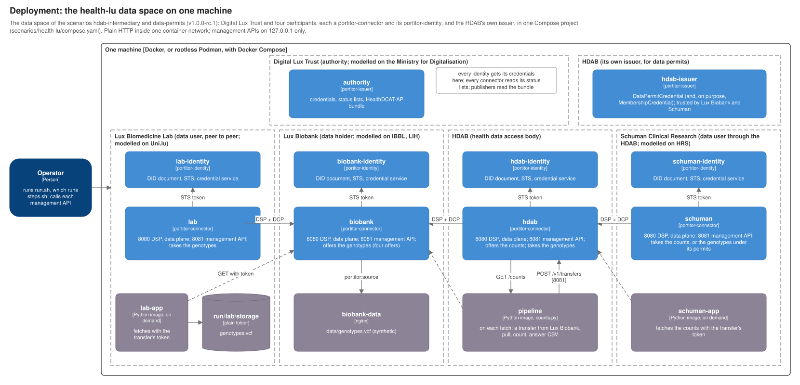

<!--
SPDX-FileCopyrightText: Portitor contributors

SPDX-License-Identifier: Apache-2.0
-->

# health-lu: a Luxembourg-style health data space

The data space that the health scenarios run on. Five parties share
synthetic genotypes the way the European Health Data Space (EHDS,
[Regulation (EU) 2025/327](https://eur-lex.europa.eu/eli/reg/2025/327/oj))
plans it for secondary use. It is not a scenario itself: it is the
cast, the data, the datasets and the script that starts everything and
runs the scenarios.

| Scenario | What it shows |
| --- | --- |
| [hdab-intermediary](../hdab-intermediary/) | The HDAB pulls the genotypes, counts, and passes on only the counts |
| [data-permits](../data-permits/) | The HDAB grants data permits as credentials; Lux Biobank checks them itself |

Together they are the health data space demo of the
[roadmap](../../docs/ROADMAP.md#the-health-dataspace-demo). They use only
what v1.0.0-rc.1 can do, and grow as releases 1.1 to 1.3 land.



## The cast

The organisations are made up. Each one is modelled on a Luxembourg
institution that could play the role. None of those institutions takes
part in or endorses this demo. Luxembourg has not named its HDAB yet,
so the demo calls it just "HDAB".

| Party | Role in the data space | Modelled on |
| --- | --- | --- |
| Digital Lux Trust | The authority: issues the credentials and the HealthDCAT-AP bundle, and grants no data access | Ministry for Digitalisation |
| Lux Biobank | Health data holder: offers the genotypes | Integrated Biobank of Luxembourg (IBBL), part of LIH |
| Lux Biomedicine Lab | Data user, peer to peer: takes a copy of the genotypes | University of Luxembourg |
| HDAB | Health data access body: gets the genotypes and offers only counts (hdab-intermediary); issues data permits (data-permits) | Luxembourg's future HDAB |
| Schuman Clinical Research | Data user: gets the counts through the HDAB (hdab-intermediary); gets the genotypes under its permits (data-permits) | Hôpitaux Robert Schuman |

Each participant runs a `portitor-connector` and a `portitor-identity`.
Digital Lux Trust runs `portitor-issuer`, and so does the HDAB, for its
data permits. All of it runs in one Compose file
on one machine ([compose.yaml](compose.yaml)), 12 containers in all.
Two more run only when needed: the two data users' apps, which fetch the
data of a started transfer.

The credentials are the ones Portitor already knows
([examples/issuer-credentials.json](../../examples/issuer-credentials.json)):

| Participant | `MembershipCredential` `role` | `DataProcessorCredential` `processing` |
| --- | --- | --- |
| Lux Biobank | `data-holder` | none |
| Lux Biomedicine Lab | `data-user` | `eu` |
| HDAB | `health-data-access-body` | none |
| Schuman Clinical Research | `data-user` | none |

The `role` values are demo values. No specification defines them.

## The data

[data/genotypes.vcf](data/genotypes.vcf) holds synthetic genotypes:
410 variants on 100 kb of simulated human DNA, for 150 people, 50 in
each of three populations (YRI, CEU and CHB, the names of the
out-of-Africa model of [Gutenkunst et al., 2009](https://doi.org/10.1371/journal.pgen.1000695)).
Each person's population is in the VCF header (`##SAMPLE` lines, as the
VCF 4.3 specification shows them). No real person is in the file.

[data/generate.py](data/generate.py) makes it with
[msprime](https://tskit.dev/msprime/) 1.3.4 and
[stdpopsim](https://popsim-consortium.github.io/stdpopsim-docs/) 0.3.0,
with a fixed seed. Both are GPL-3.0. They run only to make the file and
are not shipped. The GNU GPL FAQ says a program's output is generally
not covered by the program's licence
([GPL FAQ](https://www.gnu.org/licenses/gpl-faq.html#WhatCaseIsOutputGPL)).
The file is licensed like the rest of the repository.

Why not real data? None of the public synthetic or open genomic datasets
we checked (the CINECA synthetic cohorts, HAPNEST, 1000 Genomes) states
a licence that lets us copy it into this repository.

## The datasets

Two datasets, by two publishers, both in HealthDCAT-AP and checked
against the data space's release 8 bundle when each connector starts:

- Lux Biobank's **genotypes** ([datasets/biobank.json](datasets/biobank.json)),
  health categories HGPD (human genetic data) and EINS (biobanks). Two
  offers: one for access bodies (`MembershipCredential.role` =
  `health-data-access-body`, until 2027-12-31), one for EU processors
  (`DataProcessorCredential.processing` = `eu`, until 2027-06-30).
- Two more offers of the genotypes, one per data permit, for
  data-permits: `DataPermitCredential.permitId` = `P-2026-001` (or
  `P-2026-002`) and `DataPermitCredential.purpose` =
  `scientific-research`, until 2027-12-31.
- The HDAB's **carriers of each variant per population**
  ([datasets/hdab.json](datasets/hdab.json)), health category HGPD. One
  offer for data users (`MembershipCredential.role` = `data-user`, until
  2027-12-31). `run.sh` adds a pilot offer with the same terms that ends
  a few minutes after the start, to show an ended offer
  (hdab-intermediary).

The health category labels come from the HealthDCAT-AP code list as
[metadata101/dcat-ap](https://github.com/metadata101/dcat-ap/blob/main/resources/thesauri/theme/health-healthcategory.rdf)
copies it. The official page could not be read from here.

The HDAB issuer's credential definitions are in
[hdab-issuer-credentials.json](hdab-issuer-credentials.json): a
`DataPermitCredential` (claims `permitId` and `purpose`) and, on purpose,
a `MembershipCredential`, which data-permits uses to show that a trusted
issuer is trusted for every type.

The HDAB's source is its pipeline, [pipeline/counts.py](pipeline/counts.py)
(Python standard library only). It runs only when Schuman Clinical
Research's app fetches the data of a started transfer. Then it starts a
transfer from Lux Biobank under the HDAB's agreement, through the HDAB's
own management API. It pulls the genotypes, completes that transfer and
counts. For each variant it gives the people per population who carry
it. Counts from 1 to 4 show as `<5`, and a variant below 5 in every
population is left out. Nothing is kept. The pipeline stands in for a
secure processing environment (EHDS Art. 73), which this demo does not
build.

## Run it

```sh
scenarios/health-lu/run.sh                               # the release images
SCENARIOS=data-permits scenarios/health-lu/run.sh        # one scenario
CONTAINER_ENGINE=podman scenarios/health-lu/run.sh
scenarios/health-lu/run.sh <connector image> <identity image> <issuer image>
```

It needs Docker or Podman with Docker Compose, bash 4.4 or later, curl,
jq and openssl ([docs/TESTING.md, "Docker or Podman"](../../docs/TESTING.md#docker-or-podman)).
`run.sh` writes the keys into `run/`, starts the data space, has
Digital Lux Trust register the four participants and issue their
credentials, then runs each scenario's `steps.sh` in turn. By default it
runs hdab-intermediary, then data-permits. Each runs alone too, but
data-permits ends the HDAB's membership, so it never runs first.

Both take about three minutes, most of it waiting for the pilot offer to
end. `PILOT_SECONDS=60` makes that shorter. `KEEP=1` leaves everything
running, with the keys in `run/`. The management APIs are then on
`127.0.0.1`: Digital Lux Trust 18071, Lux Biobank 18101, the lab 18111,
the HDAB 18121, the HDAB's issuer 18125, Schuman Clinical Research 18131.
The key of each is in `run/<participant>/management.key`
(`run/hdab-issuer/` for the HDAB's issuer).

The check of the pipeline's count runs without containers:

```sh
cd scenarios/health-lu/pipeline && python3 -m unittest
```
