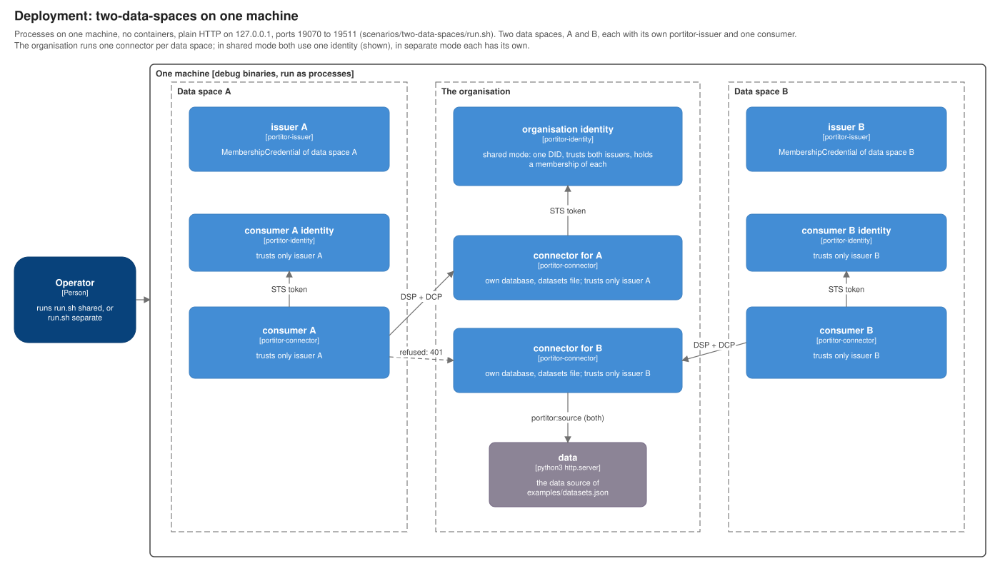
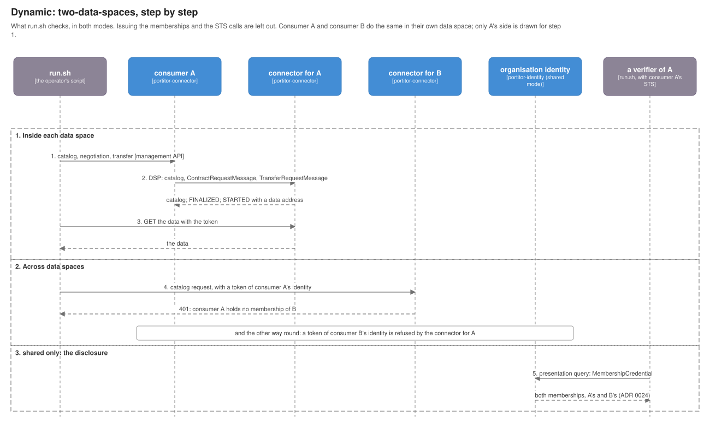

<!--
SPDX-FileCopyrightText: Portitor contributors

SPDX-License-Identifier: Apache-2.0
-->

# two-data-spaces: one organisation in two data spaces

One organisation offers the same datasets in two data spaces, with one
connector per data space. Changes are in its [changelog](CHANGELOG.md).

## What it is about

A data space has its own rules and its own trusted issuers, and one
Portitor connector serves one data space (ADR 0024). An organisation in
two data spaces therefore runs two connectors. It can share one identity,
and so one DID, between them, or run one identity per data space.

It asks: does one connector per data space keep the two apart, and what
does a shared DID disclose?



## Scope

In:

- Two data spaces, A and B, each with its own `portitor-issuer` and one
  consumer that trusts only that issuer.
- The organisation's two connectors, each with its own database,
  datasets file ([examples/datasets.json](../../examples/datasets.json))
  and trusted issuer.
- Two modes: `shared` (one identity for both connectors, with a
  membership of each issuer) and `separate` (one identity per data
  space).

Out, on purpose:

- One connector for several data spaces: planned after 1.0
  ([TD-03](../../docs/RISKS_AND_TECHNICAL_DEBTS.md#td-03)).
- Containers, a reverse proxy, a bundle, Gaia-X: plain HTTP between
  processes on one machine.

## Components tested, and why

| Component or interface | Why it is in the story |
| --- | --- |
| `portitor-issuer`, one per data space | Each issues the memberships of its own data space. |
| `portitor-identity` of the organisation | In `shared` mode, trusts both issuers and holds a membership of each; in `separate` mode, one per data space. |
| `portitor-connector`, one per data space | Trusts only its data space's issuer, so a member of the other data space is refused. |
| A consumer in each data space (identity and connector) | Reads the catalog, negotiates, transfers and fetches the data. |

## Run it

```sh
scenarios/two-data-spaces/run.sh shared
scenarios/two-data-spaces/run.sh separate
```

It builds the debug binaries and runs them as processes, without
containers, on ports 19070 to 19511. It needs Rust, curl, jq, openssl
and python3. `KEEP=1` keeps the logs. With `PORTITOR_TEST_DATABASE_URL`,
a PostgreSQL server whose user may create databases (as for the store
tests, [TESTING, "PostgreSQL"](../../docs/TESTING.md#postgresql)), each
component gets a database of its own there, dropped at the end; it then
needs `psql` too. Without it, each component keeps a SQLite file. It is not run by CI. Last run by
hand that passed: 2026-11-20, both modes
([TESTING, "Two data spaces"](../../docs/TESTING.md#two-data-spaces)).

## The steps



[run.sh](run.sh) holds the steps and their checks. In both modes:

1. **Inside each data space.** The consumer reads the catalog, agrees a
   contract, starts a transfer and fetches the data.
2. **Across data spaces.** The consumer of A is refused by the
   organisation's connector for B (HTTP 401), and the other way round.
3. **`shared` only: the disclosure.** A verifier of data space A that
   asks the shared identity for `MembershipCredential` gets both
   memberships, A's and B's. This is the disclosure ADR 0024 names.

## Findings

- **A shared DID discloses the other data space**
  ([TD-03](../../docs/RISKS_AND_TECHNICAL_DEBTS.md#td-03),
  [DEPLOYING, "Two data spaces"](../../docs/DEPLOYING.md#two-data-spaces)):
  the identity presents every credential of the type asked for, so a
  verifier in A learns that the organisation is a member of B. One DID
  per data space is the documented default.
