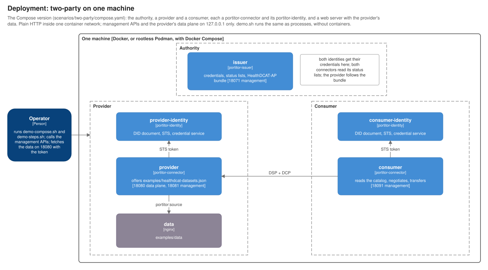
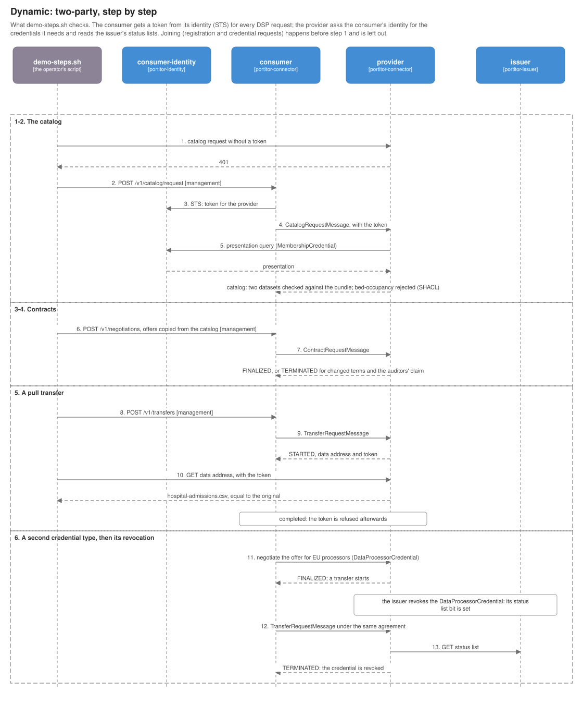

<!--
SPDX-FileCopyrightText: Portitor contributors

SPDX-License-Identifier: Apache-2.0
-->

# two-party: a provider and a consumer

The smallest data space Portitor makes. Changes are in its
[changelog](CHANGELOG.md).

## What it is about

An authority, a provider and a consumer. The consumer authenticates with
the Decentralized Claims Protocol (DCP), reads a catalog checked against
a HealthDCAT-AP bundle, agrees contracts and pulls a file. Changed
terms, a missing claim and a revoked credential are refused. It asks:
do the three components work together end to end, on every change? It
is also the [quickstart](https://bruno.pacheco.lu/portitor/#try) on the
website.

## Scope

In:

- Joining the data space: the authority registers both participants,
  each identity asks for its credentials (`MembershipCredential`, and a
  `DataProcessorCredential` for the consumer).
- DSP calls authenticated with DCP, and one refused without a token.
- The provider's datasets harvested and checked against the signed
  HealthDCAT-AP bundle; one dataset rejected by SHACL.
- Contract negotiation with credential constraints (ADR 0019), a pull
  transfer, its completion, and a refusal after revocation.

Out, on purpose:

- More than one provider or consumer, and chained transfers: see the
  health scenarios ([index](../README.md)).
- Push transfers (1.1) and purpose or data permits (1.2).
- Gaia-X compliance and other connectors: the Gaia-X and EDC interop
  tests cover them ([TESTING](../../docs/TESTING.md)).

## Components tested, and why

| Component or interface | Why it is in the story |
| --- | --- |
| `portitor-issuer` (the authority) | Registers the participants, issues and revokes credentials, builds and serves the bundle: a data space cannot start without it. |
| `portitor-identity`, one per participant | Holds the credentials, signs presentations, and is the STS that every DSP request needs (DCP). |
| `portitor-connector` as provider | Harvests and checks its datasets, serves the catalog, checks offers at negotiation and transfer, serves the data. |
| `portitor-connector` as consumer | Reads the catalog, negotiates and transfers, through its management API. |
| The built-in data plane (HTTP pull) | Serves the file with a token, refused once the transfer is complete. |
| Status lists | The provider sees the revoked `DataProcessorCredential` at once (`PORTITOR_STATUS_LIST_CACHE_SECONDS=0`). |

## Run it



```sh
scenarios/two-party/demo-compose.sh          # Docker or Podman, the release images
scenarios/two-party/demo.sh                  # binaries on this machine, built in debug
```

It takes a few seconds once the images are there. CI runs both on every
pull request, with the binaries and images it has just built.
[TESTING, "Two connectors"](../../docs/TESTING.md#two-connectors) says
what each script sets up, how to use your own images, keep the
containers running (`KEEP=1`) and add the observability stack.

## The steps



[demo-steps.sh](demo-steps.sh) checks, in this order:

1. A catalog request without a token is refused (401).
2. One made through the consumer's management API
   (`POST /v1/catalog/request`, for which the connector gets a token
   from its STS) is answered. Under the plain DSP `@context`, the two
   valid datasets carry `dct:conformsTo` with the release 8 profile and
   their metadata as full IRIs, and `bed-occupancy` is missing. The
   provider's `GET /v1/harvest-jobs/{id}` shows it rejected by the
   `shacl` check with its SHACL report.
3. The `hospital-admissions` offer copied from the catalog negotiates to
   `FINALIZED`; the same offer id without its constraint is
   `TERMINATED`.
4. The restricted `cancer-registry-extract` offer for members (the
   `memberOf` claim of the demo `MembershipCredential`, ADR 0019) is
   `FINALIZED`; its offer for auditors, a `role` claim the demo
   credential does not have, is `TERMINATED`.
5. A transfer under the first agreement: the script fetches the file
   with the token, checks it equals
   `examples/data/hospital-admissions.csv`, completes the transfer and
   checks that the token is refused afterwards. Then it transfers the
   restricted dataset under the members' agreement.
6. A second credential type (ADR 0019): the `hospital-admissions` offer
   for EU processors checks the consumer's `DataProcessorCredential`;
   it negotiates to `FINALIZED` and a transfer starts. The issuer
   revokes that credential (`POST /v1/credentials/{id}/revoke`), and a
   new transfer request under the same agreement is `TERMINATED`.

## Findings

None recorded yet. A finding from a run goes here, linked to its risk
or debt in [RISKS_AND_TECHNICAL_DEBTS](../../docs/RISKS_AND_TECHNICAL_DEBTS.md).
